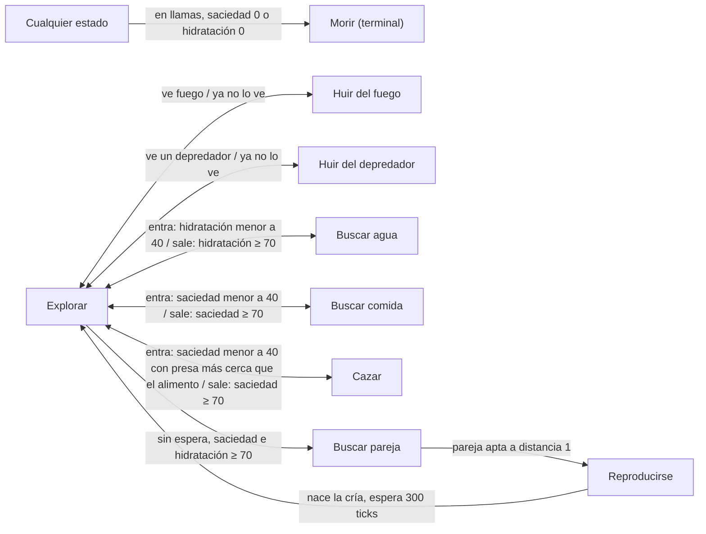
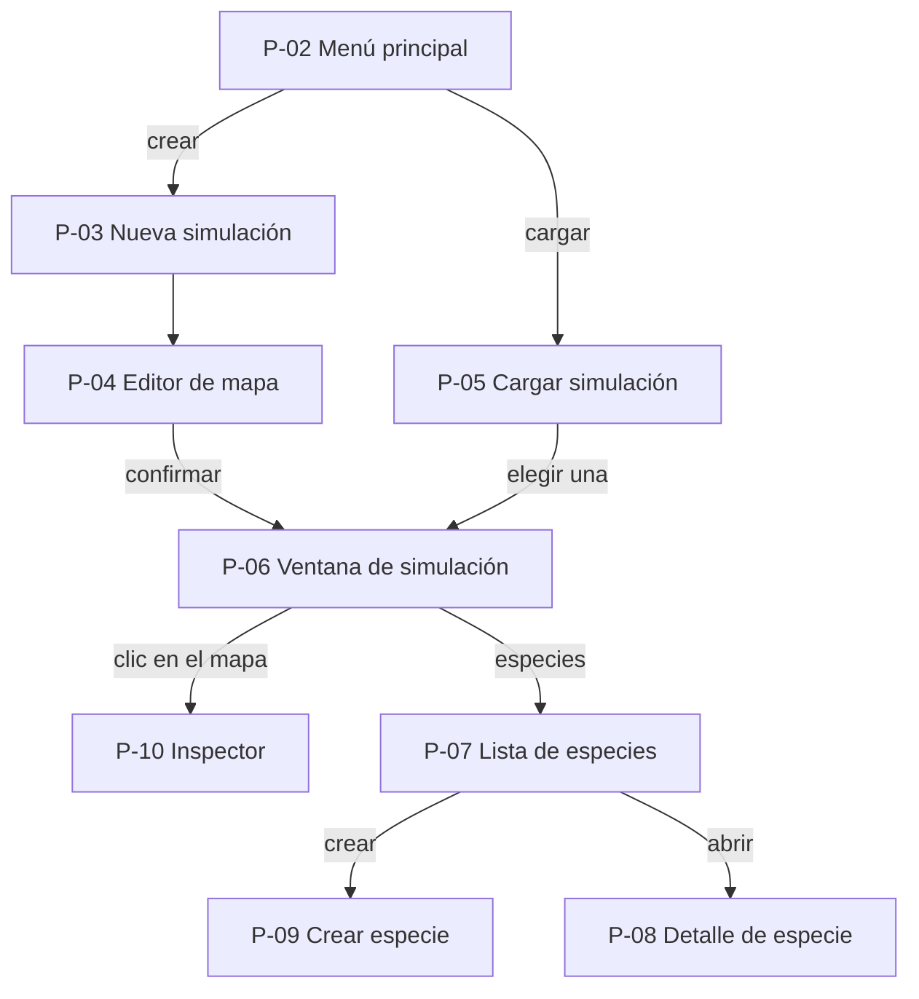

# Especificación del simulador de ecosistema

Fecha: 2026-10-12 · Actualizado: 2026-10-18 · Autor: Juan

## 1. Resumen y estado

Este documento es la especificacion definitiva del proyecto. Los valores numéricos de las secciones 4 y 5 siguen siendo iniciales y se calibrarán con la simulación en marcha.

El objetivo es una aplicación de escritorio en Python que simula un ecosistema en un mapa de 100×100 casillas. El mapa evoluciona como autómata celular (terreno, vegetación y fuego) y sobre él viven criaturas que funcionan como autómatas de estados finitos, se reproducen y mutan. El usuario observa, interviene y analiza la simulación en tiempo real.

### Estado actual del repositorio (2026-10-18)

El proyecto apenas empieza: hay estructura, documentos y configuración, **pero ningún código ni pruebas**.

| Elemento | Estado |
| --- | --- |
| `docs/` | Los cinco documentos del proyecto (`app.md`, `contratos.md`, `ecosistema.md`, `especificacion.md`, `vida.md`) |
| `src/simulador/app/`, `ecosistema/`, `vida/` | Carpetas vacías |
| Pruebas | Carpeta vacía. `pyproject.toml` apunta a `tests/`; si la carpeta del repositorio se llama `test/`, hay que renombrarla  |
| `README.md` | Ramas `main`, `develop` y `feature/subgrupo-tarea`; ciclo de git; guía de instalación (`pip install -r requirements.txt` y `pip install -e .`); prueba de humo `import simulador.app, simulador.ecosistema, simulador.vida` |
| `requirements.txt` | `numpy>=1.26`, `matplotlib>=3.8`, `pytest>=8.0`, `ruff>=0.5` |
| `pyproject.toml` | Paquete `simulador` 0.1.0, Python ≥ 3.11, pytest sobre `tests/`, ruff con línea de 100 |

**Todo lo demás que este documento nombra** (contratos en código, `MotorFalso`, `AlmacenamientoMemoria`, configuración, CI, scripts, etiquetas, `CODEOWNERS`, pruebas, prueba de oro) **es una propuesta por crear**. Versiones anteriores lo describían como existente; no lo está.

**Dependencias pendientes frente a esta especificación:** D-02 pide PySide6 y pyqtgraph, y las pruebas (secciones 6 y 9) piden `pytest-qt`, `hypothesis`, `pytest-cov` e `import-linter`; ninguno está en `requirements.txt`, que hoy incluye `matplotlib`. Decisión del 2026-10-18: se mantiene D-02; las dependencias se agregan en la tarea A-11 de `app.md` y matplotlib queda solo para scripts de análisis, no para la interfaz.

## 2. Glosario y modelo de dominio

Esta tabla reúne los términos de la aplicación con sus definiciones provisionales. La velocidad de simulación, ajustada con un deslizador, determina cuántos ticks ejecuta la simulación por segundo.

| Término | Definición |
| --- | --- |
| Simulación | Mundo completo: mapa, reloj, clima, eventos, especies y criaturas. |
| Biblioteca | Conjunto de simulaciones guardadas en el equipo. No hay cuentas ni propietarios. |
| Tick | Unidad discreta de tiempo. Todo el mundo avanza un paso por tick. |
| Velocidad de simulación | Ticks por segundo con que corre la simulación, controlados con un deslizador (antes "velocidad de reproducción"). |
| Estación, año | Una estación dura 500 ticks (valor inicial y único parámetro del calendario, ver Q-09) y un año 4 estaciones (2000 ticks). Orden: primavera, verano, otoño, invierno. |
| Casilla | Celda del mapa de 100×100. Tiene un estado: tierra, agua, pasto, árbol, en llamas o quemada. |
| Humedad | Valor de 0 a 1 por casilla, derivado de la cercanía al agua, la estación y los eventos. No se guarda. |
| Nutrientes | Nivel global del suelo de 0 a 100, controlado por el deslizador. |
| Evento natural | Sequía, lluvia o incendio, con origen natural o manual y una duración. |
| Foco | Casilla donde empieza un incendio. |
| Especie | Grupo de criaturas con nombre propio, color y estadísticas base. Solo se reproducen entre sí. |
| Criatura | Individuo con genes, estado vital y un autómata de estados finitos. |
| Gen | Estadística heredable y mutable: velocidad, fuerza, visión y tamaño. Sin topes de diseño: tienen un piso positivo, un límite técnico y un coste que crece con su valor (D-24). |
| Estado vital | Valores que cambian cada tick y no se heredan: saciedad, hidratación y espera de reproducción. La edad se registra solo como dato del inspector. |
| Cupo | Criaturas que aún caben en el mapa: el cupo global (1000 al inicio, configurable) menos las existentes. |

Entidades y atributos principales:

| Entidad | Atributos |
| --- | --- |
| Simulación | id, nombre, semilla y estado del generador aleatorio, tick, velocidad de simulación, nutrientes, temperatura, estación, eventos activos |
| Casilla | estado, contador de ticks en el estado (solo en llamas y quemada), vegetación previa (si arde), unidades de alimento (si es pasto o árbol) |
| Evento | tipo, origen (natural o manual), tick de inicio, duración, ticks restantes, focos (si es incendio) |
| Especie | id, nombre, estado (activa, extinguida, eliminada), genes base, color de la paleta (mientras está activa) |
| Criatura | id, especie, posición, genes, estado vital, edad (informativa), estado del autómata, tick de nacimiento, dirección previa al explorar, acumulador de la parte decimal de la velocidad |
| Muestra de historial | tick, especie, población, media, mínimo y máximo de cada estadística |

## 3. Decisiones y resolución de puntos abiertos

Las decisiones D-01 a D-42 se agrupan por área; D-01 a D-04 son bloqueantes y D-05 a D-08 fueron retiradas por el equipo. Las decisiones que dependían de los puntos abiertos ya reflejan lo que el equipo resolvió; el detalle de qué estaba mal en cada caso y cómo se corrige está en la resolución de los puntos abiertos, al final de esta sección. El detalle numérico vive en la sección 5.

| ID | Área | Decisión | Propuesta vigente |
| --- | --- | --- | --- |
| D-01 | Bloqueante | Modelo de estados del mapa | Una sola enumeración de 6 estados (tierra, agua, pasto, árbol, en llamas, quemada) con un contador por casilla y la vegetación previa si arde. Se descarta separar capas de terreno y fuego. |
| D-02 | Bloqueante | Plataforma y tecnología | Aplicación local de escritorio con Python 3.11 o superior, PySide6 (interfaz), NumPy (mapa), pyqtgraph (gráficas) y SQLite (persistencia). PySide6 es la interfaz de la versión 1 y no se prevé migrar a otra tecnología. El motor se mantiene como un paquete independiente de la interfaz (RNF-04), para poder probarlo sin ventana (Q-02). |
| D-03 | Bloqueante | Genes frente a estado | Genes: velocidad, fuerza, visión y tamaño. Estado vital: saciedad, hidratación y espera de reproducción. Solo los genes se heredan y mutan. Los genes no tienen topes de diseño: cada uno tiene un piso positivo, un límite técnico de seguridad y un coste metabólico creciente (D-24, Q-03). La edad se registra solo como dato del inspector (Q-11). |
| D-04 | Bloqueante | Autómata de la criatura | Nueve estados: explorar, buscar comida, buscar agua, buscar pareja, reproducirse, cazar, huir del fuego, huir del depredador y morir, con prioridades fijas (sección 5, Q-05). |
| D-05 a D-08 | Cuentas | Retiro de la gestión de cuentas | Aprobado: la versión 1 no tiene cuentas (alta, nombre y contraseña, sesión ni baja) ni nada que dependa de ellas. Las simulaciones se guardan en una biblioteca local única, sin campo de propietario. Si algún día hacen falta cuentas, se diseñarán entonces (Q-01). |
| D-09 | Mapa | Vecindad y bordes | Moore (8 vecinas), sin envoltura en los bordes, actualización síncrona con doble buffer. |
| D-10 | Mapa | Humedad | Por casilla: decae con la distancia al agua; la estación y los eventos la desplazan en todo el mapa. |
| D-11 | Mapa | Temperatura | Global, en °C, con base por estación y oscilación suave. La barra es solo de lectura. |
| D-12 | Mapa | Nutrientes | Valor global fijado por el deslizador (0 a 100, inicia en 50), modificable en cualquier momento, también con la simulación en ejecución. Las plantas no lo consumen en la primera versión. |
| D-13 | Mapa | Alimento | Pasto y árbol generan el mismo alimento genérico, con mayor probabilidad en el árbol. La probabilidad de generación depende de forma gradual de la humedad: con humedad 0 se produce el 70 % del máximo (Q-07). Las especies no definen una alimentación propia: cualquier criatura consume este alimento y, según su tamaño, puede comer a otras criaturas (D-25). |
| D-14 | Mapa | Retroceso de vegetación | La sequía no destruye el terreno ni mata criaturas, pero al bajar la humedad el pasto y el árbol pueden retroceder un nivel (árbol a pasto, pasto a tierra), según D-42. |
| D-15 | Mapa | Mapa tras iniciar | No se edita el terreno después de confirmar el editor inicial; la edición en vivo queda fuera de la versión 1. Las criaturas de una especie sí se pueden agregar en cualquier momento. |
| D-16 | Mapa | Ocupación y agua | Máximo de una criatura por casilla. El agua es intransitable; tierra, pasto, árbol y quemada son transitables (los árboles también se pisan). Para beber o comer, la criatura debe estar en una casilla adyacente a la fuente: no puede consumir de la casilla que ocupa. Los conflictos de movimiento, la ubicación de las crías y el reparto del alimento se resuelven con las reglas de la sección 5 (RF-54, Q-06). |
| D-17 | Editor | Herramientas | Pincel de agua (tamaño 1 a 5), borrador, rectángulo, limpiar todo y deshacer o rehacer (50 pasos). Se permite no poner agua, con aviso. |
| D-18 | Eventos | Alcance y combinación | Sequía, lluvia e incendio pueden ocurrir de forma aleatoria, sin intervención del usuario. Sequía y lluvia afectan todo el mapa y son excluyentes: provocar una termina la contraria. El incendio es independiente: puede coincidir con una sequía, que además aumenta su probabilidad de aparición natural. |
| D-19 | Eventos | Repetición y cancelación | No se inicia un evento del mismo tipo mientras haya uno activo; la interfaz lo avisa. El usuario puede cancelar el evento activo: la sequía y la lluvia terminan al instante y el incendio apaga todas sus casillas en llamas, que quedan como quemadas (RF-51, Q-08). |
| D-20 | Eventos | Frecuencia por estación | Eventos esperados por estación y tipo (tabla de la sección 5): el verano concentra sequías e incendios y el otoño las lluvias. La probabilidad por tick es λ / L y las duraciones son fracciones de la estación, para que el clima no cambie de carácter si cambia L (Q-09). |
| D-21 | Eventos | Incendio manual | Clic en el mapa y radio de foco de 0 a 3. Solo prende en casillas inflamables. |
| D-22 | Eventos | Propagación del fuego | Vecindad Moore; probabilidad por vecina en llamas según vegetación, humedad, temperatura y estación. El pasto arde 3 ticks y el árbol 8; ambas duraciones son provisionales y se ajustarán observando si los incendios resultan demasiado breves o demasiado largos. |
| D-23 | Criaturas | Estadísticas iniciales | Cada especie nueva se crea con valores por defecto, modificables. El formulario tiene un modo avanzado para editar los genes base. Se puede crear una especie nueva con la simulación en pausa y añadirla a la simulación en curso. Las especies no definen alimentación (D-13). |
| D-24 | Criaturas | Coste de los genes | Cada gen aumenta el consumo de saciedad e hidratación con un coste que crece con el cuadrado de su valor respecto al base. Así ningún gen puede crecer indefinidamente y cada uno tiene un valor intermedio donde conviene (Q-03). |
| D-25 | Criaturas | Uso de la fuerza y del tamaño | La fuerza decide quién actúa primero al competir por una casilla o por alimento. La depredación se rige por el tamaño: una criatura puede comer a otra de distinta especie si es al menos un 20 % más grande, y nunca a una de su propia especie. Quien come gana saciedad proporcional al tamaño de la presa (RF-53, Q-05). |
| D-26 | Criaturas | Reproducción | Sexual, con pareja de la misma especie a distancia 1. Las crías nacen adultas (no hay etapa juvenil), con saciedad e hidratación reducidas y una espera inicial de reproducción de 200 ticks. Ambas criaturas deben estar saciadas, hidratadas y sin espera; una cría por evento y coste para los dos padres. Sin casilla libre adyacente no hay nacimiento (Q-06, Q-12). |
| D-27 | Criaturas | Mutación | El valor de cada gen de la cría es el promedio de los padres multiplicado por (1 + u), con u uniforme entre −0.10 y +0.10, y se recorta al piso y al límite técnico del gen. Sustituye al intervalo [0.9 × menor, 1.1 × mayor] y a la regla original del 10 % del rango (Q-04). |
| D-28 | Criaturas | Causas de muerte | Hambre, sed, fuego y depredación (ser comida por otra criatura). No hay muerte por vejez. |
| D-29 | Criaturas | Huida del fuego | Huyen si ven fuego en su radio de visión y mueren si terminan el tick en una casilla en llamas. |
| D-30 | Especies | Ciclo de vida | Activa, extinguida (0 criaturas, por acción o natural, reactivable) o eliminada (definitiva, bloquea el nombre y borra su historial). |
| D-31 | Especies | Límite de criaturas | Cupo global, no por especie. Valor inicial de 1000, configurable y validado con pruebas de rendimiento; el enunciado original no lo fija (Q-10). Si se piden más criaturas de las que caben, se agregan las que quepan y se avisa. Los nacimientos se omiten sin coste para los padres. |
| D-32 | Especies | Eliminar una cantidad | Se eligen al azar con la semilla de la simulación. |
| D-33 | Datos | Muestreo de gráficas | Cada 10 ticks (intervalo ajustable según las pruebas): población y media, mínimo y máximo de cada estadística. Tope de 5000 muestras por especie; al excederlo se reduce a la mitad la parte antigua. |
| D-34 | Persistencia | Guardado | Manual con botón, automático cada 1000 ticks, al pausar y al cerrar. Escritura atómica. |
| D-35 | Persistencia | Formato | SQLite con versión de esquema. El estado del motor (mapa, clima, eventos, especies, criaturas y generador aleatorio) se guarda como un único blob autodescrito, con columnas de metadatos (nombre, tick, fecha, velocidad) y el historial por especie en una tabla aparte. |
| D-36 | Persistencia | Eliminar simulación | Confirmación que muestra el nombre. Es irreversible. |
| D-37 | Persistencia | Semilla | Se genera al crear, se muestra y puede fijarse a mano. Misma semilla y mismas acciones en los mismos ticks dan el mismo resultado. |
| D-38 | Interfaz | Ventana de simulación | Muestra además tick, estación y total de criaturas (n/máximo, con el máximo configurable). |
| D-39 | Interfaz | Interacción del mapa | Zoom de 1× a 8×, desplazamiento arrastrando y un inspector al hacer clic en una casilla o en una criatura. |
| D-40 | Interfaz | Identificar especies | Todas las criaturas se dibujan con una misma figura (círculo por defecto, elegible en la configuración) y cada especie se distingue por un color propio de una paleta de 12, distinto de los demás colores de especies y de los colores de las casillas. Hay como máximo 12 especies activas; el equipo puede cambiar ese límite en la configuración (RF-52, RF-55, Q-13). |
| D-41 | Interfaz | Idioma y accesibilidad | Español. Contraste mínimo de 4.5:1 en textos. La adaptación para daltonismo queda fuera de la versión 1: no hay paleta ni texturas pensadas para ello. |
| D-42 | Mapa | Evolución de la vegetación por humedad | Tierra, pasto y árbol forman una escalera de tres niveles. Cada tick, la humedad de la casilla se compara con un umbral propio del nivel (0.25 para el pasto, 0.5 para el árbol): por encima, la casilla sube de nivel con una probabilidad que crece con el exceso de humedad; por debajo, baja de nivel con una probabilidad que crece con el déficit. Una casilla cambia como máximo un nivel por tick. Sustituye al contador de 100 ticks favorables y a la dependencia directa de la distancia al agua, que ahora actúa a través de la humedad. |

### Ajustes de redacción y contradicciones resueltas

Inconsistencias que se resolvieron al contrastar las notas de la versión 0.2.

- **Alimentación (D-13, D-23):** la versión anterior definía una alimentación por especie (pasto, árboles o ambos) y los aportes grupales lo descartaron a favor de un alimento genérico. Se adoptó el alimento genérico y se retiró la alimentación de la especie en el glosario y en las entidades.
- **Vegetación (D-14, D-42):** las reglas de tierra a pasto y de pasto a árbol eran de una sola dirección (un contador de 100 ticks favorables y una probabilidad que dependía de la distancia al agua). Pasan a ser una escalera de tres niveles en la que, según la humedad, una casilla sube o baja de nivel con cierta probabilidad. Ver «Ajuste de la versión 0.4».
- **Eventos (D-18):** el texto decía a la vez que sequía y lluvia son excluyentes y que sequía e incendio conviven. Ambas cosas son compatibles: solo sequía y lluvia se excluyen.
- **Límite de criaturas (D-31):** la edición había dejado la celda solo con una nota; se restauró el comportamiento al superar el cupo.


### Resolución de los puntos abiertos

Apartir de las aportaciones grupales surgieron 13 cosas para apuntalar. Para cada uno se indica qué estaba mal, qué se decidió, cómo la decisión corrige el problema y dónde se aplicó en este documento.

#### Q-01 · Cuentas

- **Problema:** las cuentas añadían cinco requisitos funcionales (RF-01 a RF-05), uno no funcional (contraseñas con argon2id), dos pantallas y varios diálogos que no forman parte del simulador, y cuatro de esos requisitos estaban en la fase 1. Los documentos que las pedían eran un esbozo inicial.
- **Decisión:** se retira todo lo relacionado con cuentas. No se deja un campo de propietario opcional en la base de datos.
- **Cómo lo resuelve:** saca ese trabajo del alcance y simplifica la persistencia: una biblioteca local única, sin autenticación ni contraseñas. El menú principal pasa a ser la pantalla de inicio. La contrapartida aceptada es que, si algún día hacen falta cuentas, habrá que migrar los datos guardados.
- **Dónde se aplicó:** D-05 a D-08; RF-01 a RF-05 y RNF-07 retirados; RF-06, RF-07, RF-10, RF-11 y RF-12; P-01 retirada y P-02 convertida en menú principal; fases F1 y F4; trazabilidad; sección 7.

#### Q-02 · Interfaz

- **Problema:** D-02 hablaba de PySide6 «de forma provisional» con la posibilidad de pasar a Unity. Unity usa C#, y el motor, la configuración, las pruebas y la persistencia están planteados en Python. Migrar obligaba a reescribir el motor o a ejecutarlo como proceso aparte conectado por un socket.
- **Decisión:** se sigue con PySide6 y se mantiene la separación entre motor e interfaz. En el repositorio, el motor vive en `src/simulador/ecosistema` y `src/simulador/vida`, y los datos y la interfaz en `src/simulador/app`.
- **Cómo lo resuelve:** cierra la incertidumbre antes de la fase 1. La separación se conserva porque permite probar el motor sin ventana (RNF-04) y no cuesta nada mantenerla.
- **Dónde se aplicó:** D-02, sección 7 (otras interfaces fuera de alcance).

#### Q-03 · Genes sin topes

- **Problema:** el diseño anterior tenía cuatro defectos que se reforzaban entre sí.
  - Los topes de cada gen (por ejemplo, visión de 1 a 15) eran una valla externa: frenaban la evolución desde fuera y no desde el ecosistema. Al llegar al tope, la mutación se recortaba y los genes se acumulaban en los extremos.
  - El costo era lineal en el valor del gen: cada unidad extra costaba lo mismo, así que ningún valor intermedio resultaba más conveniente que otro. Con la mutación empujando hacia arriba (Q-04), la selección terminaba en el tope.
  - Al quitar los topes y añadir el gen tamaño, nada impedía valores sin límite. Una visión enorme dispara el costo de cómputo (el área que se revisa crece con el cuadrado del radio) y un tamaño sin freno rompe la depredación.
  - La regla de mutación del 10 % del rango necesitaba un rango; sin topes no hay rango (ver Q-04).
- **Decisión:** se aceptan genes sin topes de diseño. Cada gen tiene un piso positivo (20 % de su valor base), un límite técnico de seguridad y un costo metabólico que crece con el cuadrado de su valor respecto al base.
- **Cómo lo resuelve:** el costo convexo crea, para cada gen, un valor donde conviene detenerse: triplicar los cuatro genes multiplica el consumo por 3.7, y con el cuádruple una criatura consume 0.018 unidades de alimento por tick, casi toda la producción de un árbol (0.02), cuando una con genes base consume 0.003. El piso evita genes en 0, que no podrían mutar. Los límites técnicos solo protegen el rendimiento si la selección llega hasta allí (A.8).
- **Dónde se aplicó:** D-03, D-24, D-27; RF-38, RF-40; RNF-02 y RNF-10 (la propiedad pasa de «dentro de los límites de diseño» a «entre el piso y el límite técnico»); sección 5 (genes y coste); A.8, A.9; tabla de parámetros.

#### Q-04 · Mutación

- **Problema:** el intervalo [0.9 × menor, 1.1 × mayor] tenía tres defectos.
  - No está centrado en el promedio: su centro es el promedio más el 5 % de la diferencia entre los padres. Con padres de 4 y 6 el intervalo es [3.6, 6.6], centrado en 5.1 y no en 5.0, así que cada generación sube un poco aunque no haya selección.
  - Su ancho depende de cuánto difieran los padres: con padres de 4 y 6 mide 3.0 y con dos padres de 5 mide 1.0, de modo que la mutación no tiene un tamaño coherente.
  - Un gen igual a 0 nunca puede mutar.
- **Decisión:** el sesgo no era intencional. Se adopta el valor de la cría como promedio de los padres por (1 + u), con u uniforme entre −0.10 y +0.10.
- **Cómo lo resuelve:** es simétrico, así que el valor esperado de la cría es el promedio de los padres y no hay deriva hacia arriba. La variación es siempre de ±10 % del valor del gen, sin importar cuánto difieran los padres. Con padres iguales coincide con la regla anterior. El piso positivo (Q-03) evita que un gen quede atrapado en 0.
- **Dónde se aplicó:** D-27, RF-40, sección 5 (reproducción y mutación), A.9, tabla de parámetros.

#### Q-05 · Depredación

- **Problema:** la regla de comer a quien es un 20 % más pequeño tenía cinco vacíos.
  - Dentro de una misma especie, con mutaciones de ±10 %, dos hermanos pueden diferir 1.1 / 0.9 = 1.22 veces: uno podía comerse a su hermano al nacer.
  - No se definía qué gana el depredador, así que no había incentivo medible ni límite.
  - No se definía cuándo caza: sin una condición, podía exterminar una especie sin tener hambre.
  - La presa no tenía forma de detectar ni de huir, así que la depredación habría sido automática.
  - No estaba claro si un depredador prefiere una presa o la vegetación, y los depredadores figuraban como fuera de alcance. El autómata tenía solo siete estados.
- **Decisión:** se prohíbe comer a criaturas de la propia especie. La ganancia es proporcional al tamaño de la presa. Se añaden los estados cazar y huir del depredador, y huir tiene prioridad sobre buscar comida. Para completar la regla, solo se caza con hambre (saciedad menor a 40) y, entre una presa y un alimento a la vista, se va al más cercano.
- **Cómo lo resuelve:** elimina el canibalismo entre hermanos, da una ganancia finita (8 de saciedad por unidad de tamaño: una presa de tamaño base equivale a una unidad de alimento), limita la caza a la necesidad real y da a la presa la oportunidad de escapar.
- **Dónde se aplicó:** D-03, D-04, D-25, D-28; RF-36, RF-38, RF-39, RF-47 y el nuevo RF-53; sección 5 (genes, autómata de nueve estados, orden del tick, depredación, muerte); A.11; sección 7 (los depredadores entran en el alcance).

#### Q-06 · Una criatura por casilla

- **Problema:** el límite de una criatura por casilla no tenía reglas asociadas.
  - RF-37 colocaba criaturas «en casillas al azar», sin evitar repetir casilla.
  - No se decía cómo se resuelve que dos criaturas quieran la misma casilla.
  - No se decía qué pasa con la cría cuando no hay casilla libre adyacente.
  - El alimento de una casilla puede ser pedido por varias criaturas vecinas al mismo tiempo.
- **Decisión:** se acepta la propuesta con un cambio del equipo: los árboles son transitables (no son barreras). Árboles y pasto se pisan; solo el agua es intransitable.
- **Cómo lo resuelve:** las criaturas actúan en orden de fuerza descendente (empates por id): la primera obtiene la casilla o la unidad de alimento y las demás eligen otra o esperan. Sin casilla libre adyacente no hay nacimiento y los padres no pagan el coste. Las criaturas iniciales se colocan en casillas distintas. Como se come desde una casilla adyacente (D-16), una criatura que está sobre un árbol no puede comer de él y debe moverse a un lado.
- **Dónde se aplicó:** D-16, D-25; RF-37, RF-40 y el nuevo RF-54; sección 5 (movimiento y ocupación, nacimientos).

#### Q-07 · Alimento y humedad

- **Problema:** la producción tenía un umbral de humedad de 0.3: con 0.31 producía el máximo y con 0.29 nada. Una sequía (−0.35 de humedad) hacía pasar grandes zonas de producir al máximo a no producir en un solo tick, con riesgo de hambruna repentina. Además contradecía el deseo del equipo de que la producción dependa solo «ligeramente» de la humedad.
- **Decisión:** se acepta la probabilidad gradual P × (1 − s_h + s_h × h) con s_h = 0.3, sin umbral. Con humedad 1 se mantienen 0.02 en el árbol y 0.005 en el pasto.
- **Cómo lo resuelve:** la producción cambia de forma continua: con humedad 0 es el 70 % del máximo (0.0140 en el árbol) y con humedad 1 es el 100 %. Una sequía de −0.35 la reduce, como mucho, 10.5 puntos del máximo (0.3 × 0.35).
- **Dónde se aplicó:** D-13, RF-24, sección 5 (alimento), A.5, tabla de parámetros (desaparece la humedad mínima para generar alimento).

#### Q-08 · Cancelar eventos

- **Problema:** no había forma de cancelar un evento, y para el incendio no estaba definido qué pasa con las casillas ya en llamas. Un evento provocado por error obligaba a esperar a que terminara o a cargar un guardado.
- **Decisión:** se acepta un botón de cancelar por cada evento activo. La sequía y la lluvia terminan al instante; en un incendio, las casillas en llamas se apagan y quedan como quemadas.
- **Cómo lo resuelve:** la regla es simple y determinista (se aplica al inicio del siguiente tick, como los eventos manuales). Las casillas quemadas se regeneran con la regla normal, y la vegetación no se recupera gratis.
- **Dónde se aplicó:** D-19; RF-18, RF-19, RF-31 y el nuevo RF-51; P-06; sección 5 (eventos).

#### Q-09 · Duración de la estación

- **Problema:** las probabilidades y las duraciones de los eventos estaban en ticks absolutos. Si el equipo aumenta la duración de la estación, el clima cambia de carácter sin avisar: dejar la probabilidad de sequía de verano en 0.001 por tick y pasar de 500 a 1000 ticks por estación duplica las sequías por verano (de 0.5 a 1.0) y acorta su duración relativa a la mitad (de 0.3 a 0.6 de la estación a 0.15 a 0.30).
- **Decisión:** se expresan los eventos como eventos esperados por estación (λ) y las duraciones como fracción de la estación. La probabilidad por tick es λ / L, con L los ticks por estación, que pasa a ser el único parámetro del calendario.
- **Cómo lo resuelve:** cambiar L cambia la velocidad del ciclo, no su carácter. Quedan fuera las constantes de vegetación, fuego y criaturas, que dependen del tick y no del calendario; si L cambia mucho, hay que revisar cuánto crece la vegetación por estación.
- **Dónde se aplicó:** D-20; sección 5 (calendario y eventos); tabla de parámetros; A.7 y A.10.

#### Q-10 · Límite de criaturas

- **Problema:** Se tenia el valor de 1000 como limite de poblacion como un requisito fijo.
- **Decisión:** el cupo de 1000 es un valor inicial configurable que se valida con pruebas de rendimiento. El enunciado original pasa a tener menos peso: esta especificación es la fuente de verdad.
- **Cómo lo resuelve:** el equipo puede subir o bajar el cupo según lo que midan las pruebas, sin tener que justificar una desviación.
- **Dónde se aplicó:** sección 1, D-31, RF-17, RF-41, RNF-02, RNF-09, F2, sección 8 (avisos del cupo), A.10.

#### Q-11 · Edad

- **Problema:** la edad seguía en el estado vital y en las reglas (muerte a los 1500 ticks, madurez a los 200) aunque D-28 quitó la muerte por vejez y D-26 hace adultas a las crías. No influía en nada y seguía ocupando reglas, parámetros y pruebas.
- **Decisión:** se conserva solo como dato del inspector.
- **Cómo lo resuelve:** se retiran las reglas de madurez y vejez y sus parámetros. La edad sigue visible al inspeccionar una criatura, sin afectar al comportamiento. El retraso de la reproducción lo cubre la espera inicial (Q-12).
- **Dónde se aplicó:** D-03, D-26, D-28; glosario; RF-38, RF-47; autómata; A.9; tabla de parámetros.

#### Q-12 · Reproducción de la cría

- **Problema:** la cría nace con saciedad e hidratación de 60 y la reproducción exige 70. Con agua y comida a mano, bastan un tick bebiendo (+20) y una unidad de alimento (+40) para quedar apta: unos pocos ticks. Una cría podía reproducirse casi de inmediato y la población crecía de forma explosiva hasta el cupo.
- **Decisión:** se acepta una espera inicial de reproducción para las crías, de 200 ticks, reutilizando el contador de espera que ya existe.
- **Cómo lo resuelve:** impone un retraso real (el mismo que antes daba la edad de madurez) sin necesitar edad. El nacimiento con 60 de saciedad e hidratación se mantiene como segunda barrera.
- **Dónde se aplicó:** D-26, RF-40, sección 5 (reproducción), A.9, tabla de parámetros.

#### Q-13 · Colores de especies

- **Problema:** con una sola figura, el color es lo único que distingue a las especies, y los colores distinguibles entre sí y de las seis casillas son pocos. Sin un límite de especies, tarde o temprano dos se verían iguales. La paleta anterior (Okabe-Ito) tampoco servía: el azul #0072B2 se parece al del agua (distancia de color 16) y el naranja #D55E00 al del fuego (distancia 15).
- **Decisión:** se limitan las especies activas, con un límite que los desarrolladores pueden modificar si lo ven necesario. El daltonismo queda fuera de alcance (D-41).
- **Cómo lo resuelve:** el límite inicial es de 12 especies activas con una paleta fija de 12 colores, cuya distancia de color (CIE76) es de al menos 35 respecto a las casillas y de al menos 45 entre sí, y una prueba lo verifica. Siempre hay un color libre. Subir el límite exige ampliar la paleta y volver a medir las distancias.
- **Dónde se aplicó:** D-40, D-41; RF-52 y RF-55; P-07, P-09; sección 8 (sistema visual, sin texturas); RNF-11; F4; A.10.

#### Ajuste de la versión 0.4 · Evolución de la vegetación por humedad

- **Problema:** la tierra pasaba a pasto con una probabilidad que dependía de la distancia al agua, y el pasto pasaba a árbol tras 100 ticks seguidos con humedad y nutrientes suficientes. Ambos pasos eran de una sola dirección: una vez que había pasto o árbol, ninguna sequía lo hacía retroceder, y el umbral de humedad del árbol era un corte brusco (0.5 sí, 0.49 no) que reiniciaba un contador.
- **Decisión:** la evolución de tierra a pasto y de pasto a árbol depende de la humedad y es probabilística en los dos sentidos: según las condiciones de humedad, una casilla tiene una probabilidad de subir de nivel o de bajar de nivel (D-42).
- **Cómo lo resuelve:** cada nivel tiene un umbral de humedad. La probabilidad de subir crece de forma continua con el exceso de humedad sobre el umbral (0 justo en el umbral) y la de bajar crece con el déficit; así no hay saltos bruscos, el mismo criterio que se adoptó para el alimento (Q-07). La distancia al agua deja de aparecer en la fórmula del pasto porque ya está en la humedad (D-10). El pasto y el árbol se adaptan a las estaciones y a los eventos: una sequía reduce la franja de vegetación y la lluvia la recupera. El árbol, más caro de formar, retrocede más despacio que el pasto.
- **Riesgos a calibrar:** (1) los umbrales (0.25 y 0.5) y las tasas de bajada (0.01 y 0.005) son valores iniciales; (2) la sequía actúa dos veces sobre el pasto, bajando la humedad (m_ev) y multiplicando por 0.3 su crecimiento (f_ev, RF-29), así que conviene medir si el efecto total es demasiado fuerte; (3) D-14 cambia: la sequía ya no «solo frena», también puede hacer retroceder la vegetación.
- **Dónde se aplicó:** D-14, D-42; RF-22, RF-23 y el nuevo RF-56; sección 5 (orden del tick, mapa y vegetación, tabla de parámetros); A.3, A.4 y A.7; entidad Casilla; fase F1 y trazabilidad.

## 4. Requisitos funcionales

Hay 51 requisitos vigentes, cada uno con un criterio de aceptación comprobable en formato Dado, Cuando, Entonces. RF-01 a RF-05 se retiraron con las cuentas y sus números no se reutilizan; RF-51 a RF-56 son nuevos. La columna Fase indica cuándo se entrega (F1 mundo vivo, F2 criaturas, F3 eventos, F4 análisis y pulido; detalle en la sección 7).

### Simulaciones y editor de mapa

| ID | Requisito | Criterio de aceptación | Fase |
| --- | --- | --- | --- |
| RF-06 | Menú principal | Dado que se abre la aplicación, entonces se muestra el menú principal con crear o cargar simulación. Sin simulaciones guardadas, cargar muestra un estado vacío con acceso directo a crear. | F1 |
| RF-07 | Crear simulación | Dado el menú, cuando se elige crear y se indica un nombre que no usa otra simulación guardada, entonces se abre el editor con 100×100 casillas de tierra, nutrientes en 50, tick 0 y primavera. | F1 |
| RF-08 | Editor de mapa | Dado el editor, cuando se pinta con el pincel de agua, entonces esas casillas pasan a agua; el borrador las devuelve a tierra y deshacer revierte el último trazo (hasta 50 pasos). | F1 |
| RF-09 | Confirmar el editor | Dado el editor, cuando se confirma, entonces se abre la ventana de simulación en pausa con tick 0. Si no hay agua, se avisa y se pide confirmación. | F1 |
| RF-10 | Cargar simulación | Dada la lista de simulaciones guardadas, cuando se elige una, entonces se abre en pausa con el estado exacto guardado. | F1 |
| RF-11 | Renombrar simulación | Dada una simulación abierta, cuando se cambia el nombre a uno que no usa otra simulación guardada, entonces el título se actualiza y se guarda. | F1 |
| RF-12 | Eliminar simulación | Dada una simulación abierta, cuando se confirma el diálogo que muestra su nombre, entonces se borra de la biblioteca y se vuelve al menú principal. | F1 |

### Ventana de simulación

| ID | Requisito | Criterio de aceptación | Fase |
| --- | --- | --- | --- |
| RF-13 | Visualizar el mapa | Dada la ventana abierta, cuando el tick avanza, entonces cada casilla se pinta con el color de su estado según la leyenda y las criaturas se dibujan encima. | F1 |
| RF-14 | Pausar y reanudar | Dada una simulación abierta, cuando se pulsa el botón, entonces el tick se detiene o continúa y la etiqueta del botón cambia. | F1 |
| RF-15 | Velocidad de simulación | Dado el deslizador de 1 a 60 ticks por segundo, cuando se mueve, entonces el ritmo cambia sin perder estado y el valor se guarda. | F1 |
| RF-16 | Nutrientes del suelo | Dado el deslizador de 0 a 100, cuando se mueve, entonces el valor global cambia al instante y se usa desde el siguiente tick. | F1 |
| RF-17 | Reloj y temperatura | Dada la ventana abierta, entonces muestra la barra de temperatura (solo lectura), el tick, la estación y el total de criaturas (n/cupo, con cupo inicial de 1000). | F1 |
| RF-18 | Etiqueta de eventos | Dados eventos activos, entonces la etiqueta los lista con sus ticks restantes y un botón para cancelar cada uno. Sin eventos dice "Sin eventos". | F3 |
| RF-19 | Acciones en pausa | Dada la pausa, cuando se crean especies, se agregan criaturas, se mueven los nutrientes, se provoca o se cancela un evento, entonces el cambio se registra al instante y su efecto avanza al reanudar. | F2 |
| RF-20 | Zoom, desplazamiento e inspector | Dado el mapa, cuando se usa la rueda, se arrastra o se hace clic en una casilla o criatura, entonces hay zoom de 1× a 8×, desplazamiento y un inspector con sus datos. | F4 |

### Mapa como autómata celular

| ID | Requisito | Criterio de aceptación | Fase |
| --- | --- | --- | --- |
| RF-21 | Estaciones | Dado el reloj, cuando se cumplen los ticks de una estación (500 al inicio), entonces cambia la estación en el orden primavera, verano, otoño, invierno y la temperatura base sigue a la estación. | F1 |
| RF-22 | Tierra a pasto | Dada una casilla de tierra con humedad de al menos 0.25, entonces pasa a pasto con una probabilidad por tick que crece con el exceso de humedad sobre 0.25 (sección 5). Dada una semilla fija y 10 000 ticks, la fracción de pasto a 3 casillas del agua o menos supera a la fracción a 20 o más. Con nutrientes en 0 no aparece pasto nuevo. | F1 |
| RF-23 | Pasto a árbol | Dado un pasto con humedad de al menos 0.5 y nutrientes de al menos 40, entonces pasa a árbol con una probabilidad por tick que crece con el exceso de humedad sobre 0.5. Con humedad menor de 0.5 o nutrientes menores de 40 no pasa a árbol. | F1 |
| RF-24 | Alimento de la vegetación | Dado un árbol o un pasto con humedad h, entonces genera alimento con probabilidad P × (0.7 + 0.3 × h) por tick, con P = 0.02 el árbol y 0.005 el pasto, hasta 3 y 1 unidades. Con humedad 1 produce P y con humedad 0, el 70 % de P. Una criatura come desde una casilla adyacente y descuenta 1 unidad. | F1 |
| RF-25 | Agua fija | Dada cualquier casilla de agua, entonces conserva su estado durante toda la simulación. | F1 |
| RF-26 | Regeneración | Dada una casilla quemada, cuando pasan 150 ticks, entonces vuelve a tierra y puede crecer pasto de nuevo. | F3 |
| RF-56 | Retroceso de la vegetación | Dado un árbol con humedad menor de 0.5, entonces vuelve a pasto con una probabilidad por tick que crece con el déficit de humedad; dado un pasto con humedad menor de 0.25, vuelve a tierra con una probabilidad por tick que crece con el déficit. Una casilla que retrocede pierde el alimento que exceda el máximo de su nuevo estado. Una casilla en llamas o quemada no cambia de nivel por humedad. Una casilla cambia como máximo un nivel por tick. | F1 |

### Eventos naturales

| ID | Requisito | Criterio de aceptación | Fase |
| --- | --- | --- | --- |
| RF-27 | Aparición natural | Dada una estación, entonces cada tick se sortea cada evento con probabilidad λ / L, con λ los eventos esperados por estación (tabla de la sección 5) y L los ticks por estación. En 20 años simulados con semilla fija, hay más sequías en verano que en invierno y más lluvias en otoño que en verano. | F3 |
| RF-28 | Provocar un evento | Dada la ventana, cuando se pulsa el botón de un evento, entonces se activa con su duración y aparece en la etiqueta. El incendio pide elegir el foco en el mapa. | F3 |
| RF-29 | Sequía | Dada una sequía activa, entonces la humedad baja 0.35 en todo el mapa, el crecimiento de la vegetación se multiplica por 0.3 y la temperatura sube 3 °C. | F3 |
| RF-30 | Lluvia | Dada una lluvia activa, entonces la humedad sube 0.35, el crecimiento se multiplica por 1.5 y cada casilla en llamas se apaga con probabilidad 0.30 por tick. | F3 |
| RF-31 | Exclusión y repetición | Dada una sequía activa, cuando se provoca una lluvia, entonces la sequía termina, y a la inversa. Un incendio puede coincidir con cualquiera de las dos. Provocar un evento del mismo tipo que uno activo se rechaza con un aviso. | F3 |
| RF-51 | Cancelar un evento | Dado un evento activo, cuando se pulsa su botón de cancelar, entonces termina al inicio del tick siguiente y desaparece de la etiqueta. Si es un incendio, sus casillas en llamas pasan a quemada. | F3 |

### Incendios

| ID | Requisito | Criterio de aceptación | Fase |
| --- | --- | --- | --- |
| RF-32 | Inicio del incendio | Dado un incendio natural, entonces empieza en una casilla inflamable al azar. Dado uno manual, cuando se hace clic con radio de foco de 0 a 3, entonces se prenden las casillas inflamables del foco. Sin casillas inflamables, se avisa y no se crea el evento. | F3 |
| RF-33 | Propagación | Dada una casilla de pasto o árbol vecina de una en llamas, entonces se incendia con probabilidad por vecina según vegetación, humedad, temperatura y estación. El árbol es más inflamable que el pasto. Tierra y agua nunca arden. | F3 |
| RF-34 | Extinción | Dada una casilla en llamas, cuando pasan 3 ticks (pasto) u 8 (árbol), entonces pasa a quemada. El incendio termina cuando no queda ninguna casilla en llamas. | F3 |
| RF-35 | Efectos sobre la vegetación | Dada una casilla que se incendia, entonces pierde su alimento y su vegetación; al quemarse queda como quemada. | F3 |
| RF-36 | Efectos sobre criaturas | Dada una criatura que ve fuego en su radio de visión, entonces pasa al estado huir del fuego. Si termina el tick en una casilla en llamas, muere. | F3 |

### Especies y criaturas

| ID | Requisito | Criterio de aceptación | Fase |
| --- | --- | --- | --- |
| RF-37 | Crear especie | Dada la simulación en pausa, cuando se indica un nombre libre y una cantidad inicial (y, en modo avanzado, los genes base), entonces se crea la especie con un color de la paleta y se colocan esas criaturas en casillas distintas de tierra, pasto o árbol al azar, hasta el cupo. | F2 |
| RF-38 | Estadísticas de la criatura | Dada una criatura, entonces tiene velocidad, fuerza, visión y tamaño como genes, y saciedad e hidratación (de 0 a 100) y espera de reproducción como estado vital. Su edad se registra y se muestra en el inspector, sin efecto en su comportamiento. | F2 |
| RF-39 | Comportamiento | Dado el autómata de la criatura, entonces solo transita entre los nueve estados definidos y respeta las prioridades de la sección 5. Una criatura con sed baja y comida visible bebe antes que comer si su hidratación es la menor. | F2 |
| RF-40 | Reproducción y mutación | Dadas dos criaturas de la misma especie que cumplen los requisitos y una casilla libre adyacente, cuando se reproducen, entonces la cría tiene cada gen igual al promedio de los padres por (1 + u), con u uniforme entre −0.10 y +0.10, sin bajar del piso ni superar el límite técnico del gen, y nace con una espera de reproducción de 200 ticks. | F2 |
| RF-41 | Límite de criaturas | Dado el mapa con tantas criaturas como el cupo (1000 al inicio), entonces no se crean criaturas nuevas ni nacimientos, y los padres no pagan el coste de reproducirse. | F2 |
| RF-42 | Agregar criaturas | Dada una especie activa o extinguida, cuando se agregan N criaturas aleatorias, entonces se agregan min(N, cupo) y, si N supera el cupo, se informa cuántas se agregaron. | F2 |
| RF-43 | Eliminar criaturas | Dada una especie, cuando se eliminan N criaturas, entonces se retiran N al azar (o todas si hay menos). Una especie sin criaturas pasa a extinguida. | F2 |
| RF-44 | Extinguir especie | Dada una especie, cuando se extingue, entonces se retiran todas sus criaturas y la especie sigue en la lista, marcada como extinguida, con opción de agregar criaturas. | F2 |
| RF-45 | Eliminar especie | Dada una especie, cuando se confirma, entonces desaparece de la lista, su nombre queda bloqueado en esa simulación y su historial se borra. | F2 |
| RF-46 | Datos de la especie | Dada una especie, cuando se abre su detalle, entonces hay gráficas de población y de cada estadística (media, mínimo y máximo) a lo largo de los ticks. | F4 |
| RF-47 | Muerte | Dada una criatura con saciedad 0, con hidratación 0, en una casilla en llamas o comida por otra criatura, entonces muere y deja de contar en el cupo en ese mismo tick. | F2 |
| RF-52 | Límite de especies activas | Dado el máximo de especies activas (12 al inicio, configurable), cuando se intenta crear o reactivar una especie con todas las plazas ocupadas, entonces se rechaza con un aviso que sugiere extinguir o eliminar una. | F2 |
| RF-53 | Depredación | Dadas dos criaturas de distinta especie, la primera con tamaño de al menos 1.2 veces el de la segunda, cuando la primera tiene saciedad menor a 40, está en estado cazar y la segunda está en una casilla adyacente, entonces se la come: la presa muere y la primera gana 8 de saciedad por cada unidad de tamaño de la presa. Dadas dos criaturas de la misma especie, nunca se comen entre sí, aunque sus tamaños difieran. | F2 |
| RF-54 | Una criatura por casilla | Dado cualquier tick, entonces no hay dos criaturas en la misma casilla ni criaturas en el agua. Si dos quieren la misma casilla, actúa primero la de mayor fuerza (empates por id) y la otra no entra. Sin casilla libre y transitable adyacente a los padres, no hay nacimiento. | F2 |
| RF-55 | Color de la especie | Dadas las especies activas, entonces cada una tiene un color distinto de la paleta de 12, y ninguno coincide con los de las casillas. Al extinguirse una especie, su color queda libre. | F2 |

### Persistencia

| ID | Requisito | Criterio de aceptación | Fase |
| --- | --- | --- | --- |
| RF-48 | Guardado manual y automático | Dada una simulación abierta, entonces se guarda con el botón, cada 1000 ticks, al pausar y al cerrar. | F1 |
| RF-49 | Estado completo | Dada una simulación guardada y cargada, entonces mapa, clima, eventos, especies, criaturas (incluidos su dirección previa y su acumulador de velocidad), historial y generador aleatorio son idénticos. Misma semilla y mismas acciones dan el mismo resultado. | F1 |
| RF-50 | Integridad | Dado un cierre brusco durante un guardado, entonces la última versión guardada completa sigue siendo válida al reabrir. | F1 |

### Requisitos retirados

Los requisitos de cuentas se retiraron junto con la gestión de cuentas (D-05 a D-08, Q-01). Sus números no se reutilizan, para conservar la trazabilidad.

| ID | Requisito retirado | Motivo |
| --- | --- | --- |
| RF-01 a RF-05 | Crear cuenta, validar nombre y contraseña, modificarlos, iniciar y cerrar sesión, eliminar cuenta | La versión 1 no tiene cuentas |

## 5. Reglas de simulación

Cada tick ejecuta once pasos en un orden fijo, y el orden importa: una casilla que se incendia no crece en ese mismo tick y una criatura muerta no se reproduce. Los símbolos de las fórmulas se explican en la tabla de parámetros al final de esta sección, y la justificación de cada fórmula y de cada constante está en el anexo (sección 10).

### Orden del tick

1. Reloj: avanzar tick y estación, y recalcular la temperatura.
2. Eventos: terminar los vencidos y los cancelados, sortear los naturales y aplicar sus modificadores.
3. Humedad: recalcular la de cada casilla.
4. Fuego: propagar, apagar y quemar, leyendo el estado del tick anterior (doble buffer).
5. Vegetación: subida y bajada de nivel de tierra, pasto y árbol según la humedad, alimento y regeneración de quemadas, solo en casillas que el fuego no tocó este tick.
6. Percepción y decisión: cada criatura revisa su radio de visión y elige estado.
7. Acción: moverse, comer, beber y cazar. Actúan en orden de fuerza descendente y, si empatan, por id; no se puede entrar a una casilla ocupada, y una presa comida muere y libera su casilla en ese instante.
8. Metabolismo: bajan saciedad e hidratación, baja la espera de reproducción y sube la edad (solo informativa).
9. Muertes: hambre, sed y fuego; se retiran las criaturas (las comidas ya se retiraron en el paso 7).
10. Nacimientos: reproducción de las parejas aptas con una casilla libre adyacente, si hay cupo.
11. Registro: muestra de historial cada 10 ticks y guardado automático si toca.

### Calendario y clima

La temperatura es global y se calcula cada tick:

```latex
T = T_{base}(\text{estación}) + A_{día}\,\sin\!\left(\frac{2\pi\,(t \bmod 24)}{24}\right) + \Delta T_{seq}\,[\text{sequía activa}]
```

Cada estación fija la base de temperatura, el factor de humedad (k\_E), el factor de crecimiento (f\_E), el factor de inflamabilidad (f\_I) y los eventos naturales esperados por estación (λ) de cada tipo. La probabilidad por tick de un evento es λ / L, donde L son los ticks por estación (500 al inicio): al cambiar L cambia la velocidad del ciclo, no cuántos eventos ocurren por estación.

| Estación | Temp. base (°C) | k\_E humedad | f\_E crecimiento | f\_I inflamabilidad | Sequías esperadas (λ) | Lluvias esperadas (λ) | Focos naturales esperados (λ) |
| --- | --- | --- | --- | --- | --- | --- | --- |
| Primavera | 20 | 1.0 | 1.2 | 0.8 | 0.15 | 0.50 | 0.10 |
| Verano | 30 | 0.7 | 0.8 | 1.5 | 0.50 | 0.15 | 0.50 |
| Otoño | 18 | 1.0 | 1.0 | 1.0 | 0.10 | 0.75 | 0.05 |
| Invierno | 10 | 0.9 | 0.3 | 0.5 | 0.10 | 0.40 | 0.025 |

Con L = 500, el foco natural de verano tiene una probabilidad de 0.001 por tick (0.5 / 500). La probabilidad del foco natural se triplica mientras hay una sequía activa.

### Mapa: humedad, vegetación y regeneración

La humedad de cada casilla decae con la distancia al agua (distancia de Chebyshev, d) y se desplaza con los eventos:

```latex
h = \mathrm{clamp}\left(H_0 + H_1\,e^{-d/D_h}\,k_E + m_{ev},\ 0,\ 1\right)
```

Tierra, pasto y árbol forman una escalera de tres niveles. Cada tick, la humedad h de una casilla (ya recalculada en el paso 3) se compara con el umbral de su nivel: H\_p = 0.25 para el pasto y H\_a = 0.5 para el árbol. El exceso y el déficit de humedad respecto de un umbral H valen:

```latex
\varphi(h, H) = \mathrm{clamp}\left(\frac{h - H}{1 - H},\ 0,\ 1\right),\qquad \delta(h, H) = \mathrm{clamp}\left(\frac{H - h}{H},\ 0,\ 1\right)
```

Con h por encima del umbral solo hay exceso (φ > 0) y la casilla puede subir; con h por debajo solo hay déficit (δ > 0) y puede bajar. Justo en el umbral ambas valen 0. Las probabilidades por tick son:

```latex
p_{\uparrow pasto} = P_0\,\varphi(h, H_p)\,\frac{N}{100}\,f_T\,f_E\,f_{ev}\,\left(1 + B_v\,\frac{v}{8}\right),\qquad p_{\uparrow arbol} = P_A\,\varphi(h, H_a)\,[N \ge N_a]
```

```latex
p_{\downarrow pasto} = R_p\,\delta(h, H_p),\qquad p_{\downarrow arbol} = R_a\,\delta(h, H_a)
```

Aquí N es el nivel de nutrientes, N\_a los nutrientes mínimos para formar un árbol (40), v el número de vecinas con pasto o árbol, f\_T el factor de temperatura (1 entre 12 y 32 °C y bajando linealmente a 0 en 2 y 42 °C) y f\_ev el factor de eventos (0.3 con sequía, 1.5 con lluvia, 1 sin evento).

- **Tierra a pasto:** una casilla de tierra con h ≥ H\_p pasa a pasto con probabilidad p\_↑pasto.
- **Pasto a árbol:** un pasto con h ≥ H\_a y N ≥ N\_a pasa a árbol con probabilidad p\_↑árbol. Con N < N\_a no hay subida, pero tampoco bajada: los nutrientes frenan los árboles nuevos, no matan los existentes.
- **Retroceso:** un árbol con h < H\_a pasa a pasto con probabilidad p\_↓árbol, y un pasto con h < H\_p pasa a tierra con probabilidad p\_↓pasto. La casilla pierde el alimento que exceda el máximo de su nuevo estado (3 y 1 unidades en árbol y pasto, 0 en tierra).
- **Un nivel por tick, con doble buffer:** cada casilla se evalúa con el estado del tick anterior y cambia como máximo un nivel. Las casillas en llamas o quemadas no se evalúan.
- **Alimento:** árbol y pasto generan alimento con probabilidad p\_alim por tick (fórmula abajo), con P\_alim = 0.02 el árbol y 0.005 el pasto, hasta 3 y 1 unidades. No hay umbral de humedad: con humedad 0 se produce el 70 % del máximo.
- **Quemada a tierra:** una casilla quemada vuelve a tierra a los 150 ticks.
- **Agua:** nunca cambia. Es fuente de hidratación y barrera contra el fuego.

La probabilidad por tick de generar alimento depende de forma gradual de la humedad h, con s\_h = 0.3:

```latex
p_{alim} = P_{alim}\,\left(1 - s_h + s_h\,h\right)
```

### Eventos naturales

- **Sequía:** dura entre 0.3 y 0.6 estaciones (150 a 300 ticks con 500 ticks por estación). Baja la humedad 0.35 en todo el mapa, multiplica el crecimiento por 0.3 y sube la temperatura 3 °C.
- **Lluvia:** dura entre 0.10 y 0.24 estaciones (50 a 120 ticks con 500 ticks por estación). Sube la humedad 0.35, multiplica el crecimiento por 1.5, reduce la inflamabilidad y apaga casillas en llamas.
- **Incendio:** no tiene duración fija; dura mientras quede alguna casilla en llamas.
- **Exclusión:** sequía y lluvia no coexisten: provocar una termina la otra. El incendio es independiente y puede coincidir con cualquiera de las dos; la sequía triplica la probabilidad del foco natural. Un evento provocado a mano se activa al inicio del siguiente tick.
- **Cancelación:** el usuario puede cancelar un evento activo; se aplica al inicio del siguiente tick. La sequía y la lluvia terminan al instante. En un incendio, todas las casillas en llamas pasan a quemada.

### Incendios

Una casilla de pasto o árbol con k vecinas en llamas (vecindad Moore) se incendia con probabilidad:

```latex
p_{ign} = 1-(1-p)^{k},\qquad p = P_{veg}\,(1-h)\,f_{Tf}\,f_I\,f_{lluvia}
```

f\_Tf es el factor de temperatura del fuego, igual a (T − 5) / 25 acotado entre 0.2 y 1.5, y f\_lluvia vale 0.3 con lluvia activa y 1 en caso contrario. Tierra y agua nunca arden.

- **Duración:** una casilla en llamas se consume en 3 ticks si era pasto y en 8 si era árbol, y pasa a quemada.
- **Apagado anticipado:** con lluvia se apaga con probabilidad 0.30 por tick; con humedad de al menos 0.8, con probabilidad 0.15 por tick. Una casilla apagada queda como quemada, sin recuperar su vegetación.
- **Efectos:** al pasar a en llamas, la casilla pierde su alimento y su vegetación (se guarda la previa para fijar la duración).
- **Fin del evento:** el incendio termina cuando no queda ninguna casilla en llamas.

### Criaturas: genes y estado vital

Los genes se heredan y mutan; el estado vital se calcula cada tick y no se hereda. Los genes no tienen topes de diseño: cada uno tiene un piso positivo (20 % de su valor base) y un límite técnico que solo protege al motor. Lo que frena el crecimiento de los genes es su coste.

| Gen | Valor base | Piso | Límite técnico | Efecto |
| --- | --- | --- | --- | --- |
| Velocidad (V) | 1.0 | 0.2 | 6 | Casillas que recorre por tick; la parte decimal se acumula. |
| Fuerza (F) | 5 | 1 | 100 | Orden de acción: las más fuertes actúan primero al competir por una casilla o por alimento. No hay combate. |
| Visión (W) | 5 | 1 | 25 | Radio (Chebyshev) de ⌊W⌋ casillas en que percibe agua, alimento, fuego, pareja, presas y depredadores. |
| Tamaño (T) | 5 | 1 | 100 | Decide quién puede comer a quién: una criatura puede comer a otra de distinta especie si su tamaño es al menos 1.2 veces el de la presa (ver depredación). |

Cada gen paga un coste que crece con el cuadrado de su valor respecto al valor base: cuanto más alto el gen, más caro cada aumento, y por eso cada gen tiene un valor donde conviene detenerse. La saciedad baja cada tick según los genes y la hidratación baja más rápido:

```latex
c_{sac} = C_0\left(1 + a_V\left(\tfrac{V}{V_0}\right)^2 + a_F\left(\tfrac{F}{F_0}\right)^2 + a_W\left(\tfrac{W}{W_0}\right)^2 + a_T\left(\tfrac{T}{T_0}\right)^2\right),\qquad c_{hid} = 1.5\,c_{sac}
```

Saciedad e hidratación van de 0 a 100. Todas las criaturas comen el mismo alimento genérico: una unidad de una casilla de pasto o árbol adyacente sube la saciedad y descuenta 1 unidad de la casilla. Comer a otra criatura también sube la saciedad (ver depredación). Beber, desde una casilla adyacente al agua, sube la hidratación en cada tick que dura. La espera de reproducción baja un punto por tick hasta llegar a 0. La edad sube un punto por tick y se muestra en el inspector, pero ninguna regla la usa.

### Criaturas: autómata de estados finitos

Hay nueve estados: explorar, buscar comida, buscar agua, buscar pareja, reproducirse, cazar, huir del fuego, huir del depredador y morir. Cada tick se evalúan estas reglas en orden y gana la primera que se cumple:

| Prioridad | Condición | Estado resultante |
| --- | --- | --- |
| 1 | Está en una casilla en llamas, o saciedad = 0 o hidratación = 0 | Morir (terminal) |
| 2 | Hay una casilla en llamas dentro de su radio de visión | Huir del fuego, hasta que ya no vea fuego |
| 3 | Hay dentro de su radio de visión una criatura de otra especie con tamaño de al menos 1.2 veces el propio | Huir del depredador, hasta que ya no la vea |
| 4 | Saciedad o hidratación por debajo de 40 | Buscar agua si la hidratación es la menor o están empatadas. Si no, cazar si ve una presa elegible y está más cerca que el alimento visible más cercano (o no ve alimento); si no, buscar comida |
| 5 | Sin espera de reproducción, saciedad y hidratación de al menos 70 | Buscar pareja; con una pareja apta a distancia 1, reproducirse |
| 6 | Ninguna de las anteriores | Explorar |



Orden de las reglas: 1 morir, 2 huir del fuego, 3 huir del depredador, 4 buscar agua, cazar o buscar comida, 5 buscar pareja, 6 explorar.

Morir y huir valen desde cualquier estado; buscar comida, buscar agua y cazar ceden el paso a explorar al llegar a 70, y reproducirse devuelve a la criatura a explorar. Una presa elegible es una criatura de otra especie con tamaño de a lo sumo 1/1.2 del propio.

Notas del comportamiento:

- **Buscar comida o agua:** si el objetivo está a la vista, avanza hacia la casilla libre más cercana desde la que pueda comer o beber (adyacente al objetivo); si no, se mueve como al explorar. Para evitar oscilar, sigue en ese estado hasta alcanzar 70.
- **Cazar:** avanza hacia la presa visible más cercana y, al quedar adyacente en su turno de acción, se la come. Si pierde de vista a la presa, se mueve como al explorar. Sigue en ese estado hasta alcanzar 70 de saciedad.
- **Explorar:** se mueve al azar y mantiene la dirección anterior con probabilidad 0.7.
- **Huir del fuego:** se mueve a la vecina libre y transitable más lejana de la casilla en llamas más cercana, sin elegir una casilla en llamas si hay otra.
- **Huir del depredador:** se mueve a la vecina libre y transitable más lejana del depredador más cercano.
- **Reproducirse:** dura un tick y el nacimiento ocurre en el paso 10 del tick.

### Criaturas: movimiento y ocupación de casillas

- **Ocupación:** hay como máximo una criatura por casilla. El agua es intransitable; tierra, pasto, árbol y quemada son transitables. Una criatura no elige como destino una casilla en llamas si hay otra opción.
- **Orden de acción:** las criaturas actúan en orden de fuerza descendente y, si empatan, por id. Cada una se mueve a una casilla libre en ese momento, incluidas las que dejaron libres criaturas que actuaron antes en el mismo tick. Si la casilla que quiere está ocupada, prueba la siguiente casilla libre que más la acerque a su objetivo; si ninguna mejora la distancia, se queda quieta.
- **Velocidad mayor que 1:** una criatura da varios pasos por tick, cada uno con las mismas reglas.
- **Comer y beber:** se hace siempre desde una casilla adyacente a la fuente, nunca desde la propia. La primera criatura en el orden de acción toma la unidad de alimento; las demás vuelven a decidir en el tick siguiente.
- **Colocación inicial:** las criaturas de una especie nueva se colocan en casillas distintas, elegidas al azar entre las transitables y libres, hasta el cupo.

### Criaturas: depredación

- **Quién puede comer a quién:** una criatura puede comer a otra si son de distinta especie y su tamaño es al menos 1.2 veces el de la presa. Dentro de una misma especie nunca hay depredación, aunque los tamaños difieran.
- **Cuándo caza:** solo cuando su saciedad está por debajo de 40 y la regla 4 del autómata la manda a cazar. No caza sin hambre.
- **Cómo se come:** en su turno de acción, si la presa está en una casilla adyacente, se la come. La presa muere en ese instante, deja libre su casilla y deja de contar en el cupo. No hay combate ni tirada de azar.
- **Qué gana:** el depredador sube su saciedad 8 puntos por cada unidad de tamaño de la presa (hasta 100). Una presa de tamaño base (5) equivale a una unidad de alimento (+40).
- **Cómo escapa la presa:** si ve a un posible depredador (regla 3), huye antes que buscar comida o agua, y se mueve a la vecina libre más lejana de él.

### Criaturas: reproducción, mutación y muerte

- **Requisitos:** dos criaturas de la misma especie, ambas en buscar pareja, a distancia 1, con saciedad e hidratación de al menos 70 y sin espera de reproducción, y al menos una casilla libre y transitable adyacente a alguna de las dos.
- **Coste:** cada padre pierde 25 de saciedad y 10 de hidratación, y espera 300 ticks para volver a reproducirse.
- **Cría:** una por evento, en una casilla libre y transitable adyacente a uno de los padres, elegida al azar con el generador de la simulación. Nace adulta, con saciedad e hidratación de 60, edad 0 y una espera inicial de reproducción de 200 ticks. Si no hay casilla libre, no hay nacimiento y los padres no pagan el coste ni esperan.
- **Mutación:** cada gen de la cría es el promedio de los padres multiplicado por (1 + u), con u uniforme entre −m y +m, y se recorta al piso y al límite técnico del gen:

```latex
g_{hijo} = \mathrm{clamp}\left(\frac{g_a + g_b}{2}\,(1+u),\ g_{piso},\ g_{lím}\right),\qquad u \sim U(-m,\ m),\quad m = 0.10
```

- **Cupo:** con tantas criaturas como el cupo (1000 al inicio) no hay nacimientos, y los padres no pagan el coste.
- **Muerte:** por hambre, sed, fuego o depredación. Las criaturas comidas se retiran en el paso 7, en el momento de ser comidas; las demás, en el paso 9. Al retirarse liberan su cupo y su casilla.

### Tabla de parámetros

Todos los valores viven en un único archivo de configuración y son puntos de partida para calibrar, no requisitos fijos. Los factores por estación y los eventos esperados están en la tabla de calendario.

| Grupo | Parámetro (símbolo) | Valor inicial |
| --- | --- | --- |
| Reloj y clima | Ticks por estación (L), único parámetro del calendario | 500 |
| Reloj y clima | Ticks por día (solo para la oscilación diaria de temperatura) | 24 |
| Reloj y clima | Amplitud de la oscilación diaria (A\_día) | 3 °C |
| Reloj y clima | Aumento de temperatura por sequía (ΔT\_seq) | 3 °C |
| Humedad | Humedad base (H\_0) | 0.1 |
| Humedad | Aporte máximo del agua (H\_1) | 0.9 |
| Humedad | Escala de distancia al agua (D\_h) | 10 casillas |
| Vegetación | Probabilidad base de tierra a pasto (P\_0) | 0.02 |
| Vegetación | Bonus por vecinas con vegetación (B\_v) | 0.5 |
| Vegetación | Umbral de humedad del pasto (H\_p), para subir a pasto y mantenerlo | 0.25 |
| Vegetación | Umbral de humedad del árbol (H\_a), para subir a árbol y mantenerlo | 0.5 |
| Vegetación | Nutrientes mínimos de pasto a árbol | 40 |
| Vegetación | Probabilidad base de pasto a árbol (P\_A) | 0.02 |
| Vegetación | Probabilidad base de retroceso, pasto a tierra o árbol a pasto (R\_p, R\_a) | 0.01 o 0.005 |
| Vegetación | Probabilidad por tick de generar alimento con humedad 1, árbol o pasto (P\_alim) | 0.02 o 0.005 |
| Vegetación | Máximo de alimento por casilla, árbol o pasto | 3 o 1 unidades |
| Vegetación | Sensibilidad de la producción de alimento a la humedad (s\_h) | 0.3 |
| Vegetación | Ticks de quemada a tierra | 150 |
| Eventos | Cambio de humedad con sequía o lluvia (m\_ev) | −0.35 o +0.35 |
| Eventos | Factor de crecimiento con sequía o lluvia (f\_ev) | 0.3 o 1.5 |
| Eventos | Eventos esperados por estación (λ) | Tabla de calendario |
| Eventos | Duración de la sequía | 0.3 a 0.6 estaciones (150 a 300 ticks) |
| Eventos | Duración de la lluvia | 0.10 a 0.24 estaciones (50 a 120 ticks) |
| Eventos | Multiplicador del foco natural con sequía | ×3 |
| Fuego | Probabilidad base de ignición, pasto o árbol (P\_veg) | 0.25 o 0.45 |
| Fuego | Ticks en llamas, pasto o árbol | 3 o 8 |
| Fuego | Factor de ignición con lluvia (f\_lluvia) | 0.3 |
| Fuego | Probabilidad de apagado por tick con lluvia | 0.30 |
| Fuego | Probabilidad de apagado por tick con humedad de al menos 0.8 | 0.15 |
| Fuego | Radio del foco manual | 0 a 3 casillas |
| Criaturas | Valor base de V, F, W y T (g\_0) | 1.0, 5, 5 y 5 |
| Criaturas | Piso de cada gen | 20 % del valor base (0.2, 1, 1 y 1) |
| Criaturas | Límite técnico de V, F, W y T | 6, 100, 25 y 100 |
| Criaturas | Consumo base de saciedad por tick (C\_0) | 0.08 |
| Criaturas | Coeficientes de coste de V, F, W y T (a\_V, a\_F, a\_W, a\_T) | 0.10, 0.05, 0.15 y 0.20 |
| Criaturas | Saciedad e hidratación iniciales de una especie nueva | 80 |
| Criaturas | Saciedad por unidad de alimento | +40 |
| Criaturas | Hidratación por tick bebiendo | +20 |
| Criaturas | Umbral de necesidad (buscar comida, agua o cazar) | 40 |
| Criaturas | Umbral de salida de búsqueda y de reproducción | 70 |
| Criaturas | Persistencia de dirección al explorar | 0.7 |
| Criaturas | Razón mínima de tamaño para comer a otra criatura | 1.2 |
| Criaturas | Saciedad ganada por unidad de tamaño de la presa | 8 |
| Criaturas | Espera entre reproducciones | 300 ticks |
| Criaturas | Espera inicial de reproducción de la cría | 200 ticks |
| Criaturas | Coste de reproducir, saciedad o hidratación | 25 o 10 |
| Criaturas | Saciedad e hidratación de la cría | 60 |
| Criaturas | Mutación (m), variación relativa máxima del valor del gen | 0.10 |
| Especies | Cupo global de criaturas (configurable) | 1000 |
| Especies | Máximo de especies activas (configurable) | 12 |
| Registro | Intervalo de muestras de historial | 10 ticks |
| Registro | Máximo de muestras por especie | 5000 |
| Registro | Intervalo de autoguardado | 1000 ticks |

## 6. Requisitos no funcionales

Los documentos de origen no fijaban plataforma, rendimiento ni arquitectura; estos 11 requisitos vigentes lo hacen (RNF-07 se retiró con las cuentas y su número no se reutiliza). Las cifras de rendimiento son propuestas que hay que medir en el equipo de referencia: 4 núcleos y 8 GB de memoria (confirmado el 2026-10-18).

| ID | Requisito | Criterio de aceptación |
| --- | --- | --- |
| RNF-01 | Plataforma | Corre con Python 3.11 o superior en Windows 10 o superior, macOS 13 o superior y Ubuntu 22.04 o superior. Se instala con los comandos de la guía del README (`pip install -r requirements.txt` y `pip install -e .`) y arranca sin configuración extra. |
| RNF-02 | Rendimiento del motor | Sin interfaz y en el equipo de referencia, el motor ejecuta al menos 60 ticks por segundo sin criaturas y al menos 30 con el cupo inicial de 1000 criaturas. Si no alcanza la velocidad pedida, la interfaz muestra la velocidad efectiva. Si las pruebas lo exigen, se ajusta el cupo (D-31). |
| RNF-03 | Fluidez de la interfaz | La ventana se redibuja a 30 FPS o más y no se congela, porque el motor corre en un hilo o proceso aparte. |
| RNF-04 | Motor separado de la interfaz | El paquete del motor no importa nada de PySide6; una prueba ejecuta 1000 ticks sin cargarlo. |
| RNF-05 | Reproducibilidad | Con la misma semilla y las mismas acciones en los mismos ticks, el estado tras 5000 ticks es idéntico en el mismo equipo y la misma versión. |
| RNF-06 | Configuración única | Ningún parámetro de la sección 5 está escrito en el código: se leen de un archivo de configuración versionado que valida rangos al arrancar. |
| RNF-07 | Retirado | Contraseñas: retirado con la gestión de cuentas (D-05 a D-08). Su número no se reutiliza. |
| RNF-08 | Persistencia robusta | El guardado es atómico y el archivo lleva versión de esquema. Abrir una simulación de una versión anterior migra el esquema o muestra un error claro sin dañarla. |
| RNF-09 | Tamaño del guardado | Una simulación con el cupo inicial de 1000 criaturas y 5000 muestras por especie ocupa menos de 20 MB. |
| RNF-10 | Pruebas | El motor tiene cobertura de al menos 80 %. Pruebas de propiedades verifican que el agua nunca cambia, el cupo nunca se supera, los genes siempre están entre su piso y su límite técnico, nunca hay dos criaturas en la misma casilla y ninguna criatura come a otra de su misma especie. |
| RNF-11 | Idioma y accesibilidad | Interfaz en español. Contraste de al menos 4.5:1 en los textos. Los colores de las especies cumplen las distancias mínimas de la paleta (RF-55). |
| RNF-12 | Errores | Un error inesperado se escribe en un registro local y muestra un mensaje sin perder el último guardado. |

## 7. Fuera de alcance y fases

La entrega se divide en cuatro fases verticales: cada una deja algo que corre y se puede probar, y no se empieza la siguiente sin cumplir el criterio de salida de la anterior.

| Fase | Entrega | Requisitos | Criterio de salida |
| --- | --- | --- | --- |
| F1 Mundo vivo | Simulaciones, editor de mapa, estaciones, vegetación, alimento, ventana con controles y guardado | RF-06 a RF-17, RF-21 a RF-25, RF-56, RF-48 a RF-50 | Una simulación sin criaturas corre 10 000 ticks con semilla fija, produce pasto y árboles cerca del agua, y se guarda y carga idéntica. |
| F2 Criaturas | Especies con paleta y límite, autómata de nueve estados, depredación, ocupación de casillas, reproducción y mutación, cupo, gestión de especies y acciones en pausa | RF-19, RF-37 a RF-45, RF-47, RF-52 a RF-55 | Una especie de 50 criaturas se reproduce y sus genes cambian durante 5000 ticks; el cupo nunca se supera, nunca hay dos criaturas en una casilla y ningún gen sale de su piso ni de su límite técnico. |
| F3 Eventos | Sequía, lluvia, incendios, cancelación de eventos, huida, etiqueta de eventos y regeneración | RF-18, RF-26 a RF-36, RF-51 | Un incendio manual se propaga, el agua lo frena y la lluvia lo apaga; cancelarlo apaga sus casillas en llamas. Las criaturas huyen del fuego y solo mueren por fuego en casillas en llamas. |
| F4 Análisis y pulido | Gráficas por especie, zoom e inspector | RF-20, RF-46 | Las gráficas de una simulación de 20 000 ticks se abren sin congelar la ventana y el inspector muestra los datos de una casilla y de una criatura, incluida su edad. |

Fuera de alcance de la versión 1:

- Cuentas, contraseñas, recuperación de contraseña, inicio de sesión con terceros y propietarios de simulaciones (retirados por D-05 a D-08).
- Multijugador, servidor o sincronización en red.
- Interfaces distintas de PySide6 (D-02).
- Dietas específicas por especie y fuentes de alimento distintas del pasto y los árboles.
- Viento, relieve, ríos o lagos dinámicos.
- Eventos localizados por zona y nutrientes por casilla.
- Edición del mapa durante la simulación, que sería la primera candidata para una fase 5.
- Genes adicionales distintos de velocidad, fuerza, visión y tamaño.
- Más de 12 especies activas a la vez, salvo que el equipo amplíe el límite y la paleta (D-40).
- Adaptación de la paleta y de las casillas para daltonismo (D-41).

## 8. Diseño de interfaz

La aplicación tiene 10 pantallas y diálogos (P-01 se retiró con las cuentas); la ventana de simulación es el centro y todo lo demás se llega desde ella o desde el menú principal.



Al abrir la aplicación se llega al menú principal. Eliminar la simulación o volver desde la ventana lleva al menú principal. Los diálogos (P-11) aparecen sobre cualquier pantalla y no se dibujan.

### Inventario de pantallas

| ID | Pantalla | Elementos principales | Requisitos |
| --- | --- | --- | --- |
| P-01 | Acceso (retirada) | Retirada con las cuentas; su número no se reutiliza | — |
| P-02 | Menú principal | Crear simulación y cargar simulación | RF-06 |
| P-03 | Nueva simulación | Nombre y semilla opcional | RF-07 |
| P-04 | Editor de mapa | Lienzo de 100×100, pincel de agua con tamaño, borrador, rectángulo, limpiar, deshacer y rehacer, confirmar | RF-08, RF-09 |
| P-05 | Cargar simulación | Lista con nombre, tick, estación, criaturas y última modificación | RF-10 |
| P-06 | Ventana de simulación | Mapa, pausa, deslizadores de velocidad y nutrientes, barra de temperatura, tick, estación, total de criaturas (n/cupo), etiqueta de eventos con botón de cancelar, botones de eventos, renombrar, eliminar, guardar y acceso a especies | RF-11 a RF-19, RF-51 |
| P-07 | Lista de especies | Color, nombre, estado y población de cada especie; botón de crear especie y aviso del límite de especies activas | RF-37, RF-42 a RF-45, RF-52, RF-55 |
| P-08 | Detalle de especie | Agregar, eliminar, extinguir y eliminar; gráficas de población y de cada estadística | RF-42 a RF-46 |
| P-09 | Crear especie | Nombre, cantidad inicial y genes base opcionales (modo avanzado); muestra el color asignado | RF-37, RF-55 |
| P-10 | Inspector | Datos de la casilla o criatura seleccionada, incluida la edad | RF-20 |
| P-11 | Diálogos | Confirmaciones, avisos de límite y errores | RF-09, RF-12, RF-41, RF-42, RF-52 |

### Estados vacíos, errores y confirmaciones

| Situación | Qué ve el usuario |
| --- | --- |
| Sin simulaciones guardadas | Lista vacía con el texto "Aún no tienes simulaciones" y el botón Crear. |
| Sin especies | Panel vacío con el botón Crear especie. |
| Nombre de simulación repetido | Mensaje junto al campo; no se avanza. |
| Mapa sin agua | Aviso de que la vegetación crecerá poco y las criaturas morirán de sed, con Continuar o Volver al editor. |
| Cupo agotado al agregar criaturas | Aviso "Se agregaron X de N por el límite de criaturas (C)", con C el cupo configurado. |
| Total de criaturas en el cupo | El indicador n/cupo se resalta. |
| Máximo de especies activas | Aviso "Ya hay 12 especies activas. Extingue o elimina una para continuar." al crear o reactivar una especie. |
| Evento ya activo | Aviso al pulsar su botón; no se duplica. |
| Evento cancelado | La etiqueta de eventos deja de listarlo en el tick siguiente. |
| Incendio sin casillas inflamables | Aviso sobre el mapa; no se crea el evento. |
| Eliminar simulación o especie | Diálogo de confirmación que muestra el nombre. |
| Cerrar la ventana | Se guarda automáticamente (RF-48) sin preguntar. Si el guardado falla, diálogo con Reintentar, Cerrar sin guardar y Cancelar. |
| Error inesperado | Mensaje con acceso al registro; el último guardado sigue intacto. |

### Sistema visual

La casilla mide 6 px por defecto (mapa de 600×600 px) y cambia con el zoom. Los colores iniciales son una propuesta que se revisará con la simulación en marcha.

| Estado de casilla | Color | Nota |
| --- | --- | --- |
| Tierra | #C9A66B | Marrón claro |
| Agua | #2E86DE | Azul medio |
| Pasto | #8BC34A | Verde claro |
| Árbol | #1B5E20 | Verde oscuro; se distingue del pasto por luminosidad |
| En llamas | #FF6D00 | Naranja intenso |
| Quemada | #3E3E3E | Gris oscuro |

Todas las criaturas se dibujan con la misma figura y un borde blanco. La figura es un círculo por defecto y se elige en el archivo de configuración entre círculo, cuadrado, triángulo y rombo. Cada especie activa lleva un color propio de esta paleta de 12, que se asigna en este orden al primer color libre: #0606F9, #06F906, #F9062F, #06D0F9, #C7A705, #EC79D9, #6AFBB3, #773E22, #223077, #F906F9, #6A6AFB y #D0F906. La distancia de color (CIE76) es de al menos 35 respecto a los colores de las casillas y de al menos 45 entre los colores de la paleta; una prueba lo comprueba. Al extinguirse una especie, su color queda libre.

## 9. Trazabilidad y registro de decisiones

Cada requisito se enlaza con su diseño y con la prueba que lo verifica; así ninguna regla queda sin pantalla ni sin prueba. Los módulos son una propuesta inicial: motor (reloj, mapa, eventos, fuego, criaturas, especies), datos (persistencia) e interfaz.

| Área | Requisitos | Pantallas | Módulo | Pruebas |
| --- | --- | --- | --- | --- |
| Simulaciones y editor | RF-06 a RF-12 | P-02 a P-05, P-11 | interfaz, datos | Integración del flujo crear, editar y confirmar; cargar y eliminar. |
| Ventana de simulación | RF-13 a RF-20 | P-06, P-10 | interfaz | Automatizadas con pytest-qt; revisión manual de fluidez. |
| Mapa como autómata | RF-21 a RF-26, RF-56 | P-06 | motor | Estadísticas con semilla fija por franja de distancia al agua; subida y retroceso de nivel con humedad fijada a mano; propiedad de que el agua nunca cambia. |
| Eventos e incendios | RF-27 a RF-36, RF-51 | P-06, P-11 | motor | Escenarios con semilla fija (foco, barrera de agua, lluvia, cancelación) y frecuencia de eventos por estación. |
| Especies y criaturas | RF-37 a RF-47, RF-52 a RF-55 | P-07 a P-09, P-11 | motor | Unitarias de la tabla de prioridades, la mutación sin sesgo, la depredación (sin canibalismo), el cupo y la ocupación de casillas; propiedades de pisos y límites técnicos de genes; distancias de la paleta. |
| Persistencia | RF-48 a RF-50, RNF-05, RNF-08, RNF-09 | P-06, P-11 | datos | Ida y vuelta idéntica; corte simulado durante el guardado; migración de esquema. |
| No funcionales | RNF-01 a RNF-04, RNF-06, RNF-10 a RNF-12 | Todas | Todos | Benchmark de ticks por segundo; prueba de que el motor no importa la interfaz; validación de configuración. |

### Registro de decisiones

| Fecha | Decisión | Estado |
| --- | --- | --- |
| 2026-10-11 | Unificar las dos descripciones en este borrador v0.1 | Hecho |
| 2026-10-11 | Archivar la segunda descripción para tener una sola fuente de verdad | Por aprobar |
| 2026-10-11 | Decisiones D-01 a D-41 con sus propuestas por defecto | Revisadas por el equipo en las versiones 0.2 y 0.3 |
| 2026-10-12 | El pasto también es alimento: cada especie define su alimentación (pasto, árboles o ambos) al crearse, y los árboles generan alimento con mayor probabilidad (D-13, D-23, RF-24, RF-37) | Reemplazado por el alimento genérico sin dieta por especie (D-13, D-23) |
| 2026-10-12 | Se pueden agregar criaturas de una especie en cualquier momento; el terreno no se edita tras iniciar (D-15) | Aplicado |
| 2026-10-12 | Anexo con la justificación de cada fórmula y constante (sección 10) | Aplicado |
| 2026-10-12 | Se elimina del requisito de idioma el archivo de cadenas para traducir después (RNF-11) | Aplicado |
| 2026-10-12 | Revisión del equipo de las secciones 1 a 3 y de los requisitos de cuentas; redacción profesionalizada en la versión 0.2 | Hecho |
| 2026-10-12 | Retiro de la gestión de cuentas, sin campo de propietario (D-05 a D-08, Q-01) | Aprobado y aplicado en la v0.3 |
| 2026-10-12 | Se sigue con PySide6 y con el motor separado de la interfaz (D-02, Q-02) | Aprobado y aplicado |
| 2026-10-12 | Gen tamaño; genes sin topes de diseño con piso y límite técnico; coste cuadrático (D-03, D-24, Q-03) | Aprobado y aplicado |
| 2026-10-12 | Mutación como promedio por (1 + u), con u entre −0.10 y +0.10 (D-27, Q-04) | Aprobado y aplicado |
| 2026-10-12 | Depredación por tamaño, prohibida dentro de la especie; estados cazar y huir del depredador (D-04, D-25, D-28, Q-05) | Aprobado y aplicado |
| 2026-10-12 | Una criatura por casilla; los árboles son transitables (D-16, Q-06) | Aprobado y aplicado, con el cambio del equipo sobre los árboles |
| 2026-10-12 | Producción de alimento gradual con la humedad (D-13, Q-07) | Aprobado y aplicado |
| 2026-10-12 | Cancelar eventos activos (D-19, Q-08) | Aprobado y aplicado |
| 2026-10-12 | Eventos esperados por estación y duraciones como fracción de la estación (D-20, Q-09) | Aprobado y aplicado |
| 2026-10-12 | El cupo de 1000 es un valor inicial configurable y el enunciado original deja de ser vinculante (D-31, Q-10) | Aprobado y aplicado |
| 2026-10-12 | La edad queda solo como dato del inspector (D-03, D-26, D-28, Q-11) | Aprobado y aplicado |
| 2026-10-12 | Espera inicial de reproducción de 200 ticks para las crías (D-26, Q-12) | Aprobado y aplicado |
| 2026-10-12 | Máximo de 12 especies activas, modificable por el equipo; paleta de 12 colores; daltonismo fuera de alcance; se retiran las texturas del fuego y la quemada, que existían solo por el daltonismo (D-40, D-41, Q-13) | Aprobado y aplicado |
| 2026-10-12 | Se corrige el anexo A.1: con sequía en verano la temperatura llega a 36 °C | Hecho |
| 2026-10-12 | Se restaura en D-31 el comportamiento al superar el cupo | Hecho |
| 2026-10-16 | La evolución de tierra a pasto y de pasto a árbol depende de la humedad y es probabilística en los dos sentidos: las casillas suben o bajan de nivel (D-14, D-42, RF-22, RF-23, RF-56; versión 0.4) | Aplicado; valores iniciales a calibrar |
| 2026-10-18 | Guardado como un único blob autodescrito del motor, con metadatos e historial en tabla aparte (D-35, A-DP-01) | Aprobado y aplicado |
| 2026-10-18 | Al cerrar se guarda sin preguntar; el diálogo solo aparece si el guardado falla (RF-48, sección 8, A-DP-02) | Aprobado y aplicado |
| 2026-10-18 | La entidad Criatura y RF-49 incluyen la dirección previa y el acumulador de velocidad (V-DP-01) | Aprobado y aplicado |
| 2026-10-18 | Equipo de referencia de 4 núcleos y 8 GB (sección 6, A-DP-05) | Aprobado y aplicado |
| 2026-10-18 | Los documentos pasan a reflejar el estado real del repositorio (solo estructura; sin código, pruebas ni CI); lo que antes figuraba como existente queda como propuesta por crear | Aplicado |
| 2026-10-18 | Python 3.11 o superior (D-02, RNF-01), como en `pyproject.toml` y el README; instalación con `pip install -r requirements.txt` y `pip install -e .` | Aplicado; pendiente de confirmar por el equipo |
| 2026-10-18 | PySide6, pyqtgraph y pytest-qt (D-02) no están en `requirements.txt`, que hoy incluye matplotlib | Cerrado: se mantiene D-02; se agregan en A-11 y matplotlib queda solo para scripts de análisis |
| 2026-10-18 | Nombres de clases, funciones, atributos, carpetas y archivos ajustados a las reglas de redacción de `docs/contratos.md` (español, sin tildes; clases en PascalCase, funciones en camelCase, atributos en snake_case) | Aplicado |

## 10. Anexo: fórmulas y constantes

Este anexo explica cada fórmula de la sección 5: qué calcula, qué significa cada símbolo y por qué se eligió cada valor. Los valores no salen de datos reales: son puntos de partida que se comprobaron con cuentas sencillas (se muestran) y se calibrarán con la simulación en marcha. En todo el anexo, d es la distancia en casillas al agua más cercana, y una casilla pegada al agua tiene d = 1.

### A.1 Temperatura

Calcula la temperatura global de cada tick a partir de la estación, la hora del día y las sequías:

```latex
T = T_{base}(\text{estación}) + A_{día}\,\sin\!\left(\frac{2\pi\,(t \bmod 24)}{24}\right) + \Delta T_{seq}\,[\text{sequía activa}]
```

| Símbolo | Significado | Valor | Por qué ese valor |
| --- | --- | --- | --- |
| T\_base | Temperatura base de la estación | 20, 30, 18 y 10 °C (primavera a invierno) | Rango de clima templado. El salto entre estaciones consecutivas es de 8 a 12 °C, así que la estación domina sobre la hora del día. |
| A\_día | Amplitud de la oscilación diaria | 3 °C | Es menos de la mitad del menor salto entre estaciones (8 °C): matiza el día y la noche sin confundirlos con un cambio de estación. |
| t mod 24 | Hora del día | 0 a 23 | Con 24 ticks por día la oscilación se ve en pantalla sin hacer que el día sea más largo que una estación. |
| ΔT\_seq | Aumento por sequía | +3 °C | Sube el factor de temperatura del fuego en 0.12 (3 / 25). En un verano con sequía la temperatura llega a 36 °C, por encima del rango de crecimiento de 12 a 32 °C, y el factor de crecimiento baja a 0.6: es parte del efecto buscado de la sequía. |

### A.2 Humedad

Calcula la humedad de cada casilla: baja con la distancia al agua, depende de la estación y se desplaza con la sequía o la lluvia.

```latex
h = \mathrm{clamp}\left(H_0 + H_1\,e^{-d/D_h}\,k_E + m_{ev},\ 0,\ 1\right)
```

| Símbolo | Significado | Valor | Por qué ese valor |
| --- | --- | --- | --- |
| H\_0 | Humedad mínima | 0.1 | Ninguna casilla queda perfectamente seca, por lejos que esté del agua. |
| H\_1 | Aporte máximo del agua | 0.9 | Hace que H\_0 + H\_1 = 1: una casilla pegada al agua en primavera u otoño tiene humedad plena. |
| D\_h | Escala de distancia | 10 casillas | Con k\_E = 1, la humedad cae a 0.5 (el mínimo para árboles) a unas 8 casillas del agua: una franja de bosque del 8 % del ancho del mapa. En verano (k\_E = 0.7) baja a unas 4.5 casillas y en invierno a unas 7. |
| k\_E | Factor de humedad de la estación | 1.0, 0.7, 1.0 y 0.9 | El verano es la estación seca; el invierno, algo menos húmeda que primavera y otoño. |
| m\_ev | Efecto de un evento | −0.35 con sequía, +0.35 con lluvia | Es lo bastante grande para cruzar el umbral de 0.5: con sequía solo las casillas a menos de unas 2 del agua lo mantienen, y con lluvia lo alcanza hasta una distancia de unas 28. Es un efecto fuerte y es de los primeros valores a calibrar. |

### A.3 Tierra a pasto

Calcula la probabilidad por tick de que una casilla de tierra se convierta en pasto. Solo hay probabilidad si la humedad supera el umbral del pasto, y crece de forma continua con el exceso de humedad:

```latex
p_{\uparrow pasto} = P_0\,\varphi(h, H_p)\,\frac{N}{100}\,f_T\,f_E\,f_{ev}\,\left(1 + B_v\,\frac{v}{8}\right),\qquad \varphi(h, H) = \mathrm{clamp}\left(\frac{h - H}{1 - H},\ 0,\ 1\right)
```

| Símbolo | Significado | Valor | Por qué ese valor |
| --- | --- | --- | --- |
| H\_p | Umbral de humedad del pasto | 0.25 | Con k\_E = 1 la humedad cae a 0.25 a unas 17 casillas del agua (14 en verano y 16 en invierno): más lejos el pasto no sale ni se mantiene, salvo con lluvia (+0.35 deja todo el mapa por encima de 0.45). Con sequía (−0.35) solo se sostiene hasta unas 5 casillas. Deja a 20 o más casillas sin pasto en condiciones normales, como pide RF-22. |
| φ | Exceso de humedad sobre el umbral | 0 a 1 | Vale 0 en el umbral y 1 con humedad 1. Sustituye al término exponencial en la distancia de la versión 0.3: la distancia al agua ya está en la humedad (A.2), y el parámetro de escala del pasto desaparece. |
| P\_0 | Probabilidad base | 0.02 | Una casilla pegada al agua (d = 1, h ≈ 0.91, φ ≈ 0.88) en primavera con nutrientes en 50 tiene p ≈ 0.011, unos 95 ticks hasta ser pasto. A 10 casillas (h ≈ 0.43) p ≈ 0.003, unos 350 ticks; a 17 casillas p ≈ 0.0002, unos 4300 ticks: el frente avanza rápido cerca del agua y casi se detiene en el borde. |
| N / 100 | Nutrientes entre 0 y 1 | Deslizador de 0 a 100 | Es lineal. Con 0 no aparece pasto nuevo (RF-22), y subir de 50 a 100 duplica la velocidad. |
| f\_T | Factor de temperatura | 1 entre 12 y 32 °C; baja linealmente a 0 en 2 y 42 °C | El rango óptimo cubre primavera, verano y otoño. En invierno (entre 7 y 13 °C) el factor queda entre 0.5 y 1. |
| f\_E | Factor de crecimiento de la estación | 1.2, 0.8, 1.0 y 0.3 | La primavera crece más, el verano menos por la sequedad y el invierno casi se detiene. |
| f\_ev | Factor de evento | 0.3 con sequía, 1.5 con lluvia, 1 sin evento | La sequía frena el crecimiento y la lluvia lo favorece (RF-29, RF-30). Ojo: la sequía ya baja la humedad, así que actúa dos veces; es de los primeros valores a calibrar. |
| B\_v | Bonus por vecinas | 0.5, aplicado a v / 8 | Con ocho vecinas con vegetación la probabilidad sube un 50 %. El pasto avanza como un frente desde las orillas en vez de salir en puntos aislados. |

### A.4 Pasto a árbol, retroceso y regeneración

Calcula las probabilidades por tick de subir y de bajar de nivel. Un árbol exige más humedad que el pasto, y el retroceso crece con el déficit de humedad respecto del umbral del nivel:

```latex
p_{\uparrow arbol} = P_A\,\varphi(h, H_a)\,[N \ge N_a],\qquad p_{\downarrow pasto} = R_p\,\delta(h, H_p),\qquad p_{\downarrow arbol} = R_a\,\delta(h, H_a),\qquad \delta(h, H) = \mathrm{clamp}\left(\frac{H - h}{H},\ 0,\ 1\right)
```

| Constante | Valor | Por qué ese valor |
| --- | --- | --- |
| H\_a, umbral de humedad del árbol | 0.5 | Limita los árboles a la franja cercana al agua (unas 8 casillas en primavera y otoño) y hace que la sequía los haga retroceder al bajar la humedad (con sequía solo se sostienen a menos de unas 2 casillas). |
| N\_a, nutrientes mínimos para formar un árbol | 40 | El deslizador inicia en 50, así que hay margen, y el usuario puede frenar los árboles nuevos bajándolo de 40. Los nutrientes no hacen retroceder a los árboles existentes. |
| P\_A, probabilidad base de pasto a árbol | 0.02 | Sustituye al contador de 100 ticks favorables. A 3 casillas del agua (h ≈ 0.77, φ ≈ 0.53) p ≈ 0.011, unos 94 ticks, casi igual que el contador anterior; pegado al agua, unos 61. En el borde de la franja (h cerca de 0.5) casi no sube. |
| R\_p, probabilidad base de pasto a tierra | 0.01 | Con déficit pleno (humedad 0) retrocede en unos 100 ticks; con un déficit moderado, mucho más despacio. Con una sequía, a 10 casillas del agua (h ≈ 0.08, δ ≈ 0.68) p ≈ 0.007: unos 150 ticks, menos que la sequía de 150 a 300. |
| R\_a, probabilidad base de árbol a pasto | 0.005 | La mitad que el pasto: el árbol tarda más en formarse y resiste más. Con una sequía, a 6 casillas del agua (h ≈ 0.24, δ ≈ 0.51) p ≈ 0.003, unos 390 ticks; a 3 casillas, más de 1000. |
| Un nivel por tick | — | Evita saltos de árbol a tierra en un solo tick y mantiene el doble buffer: cada casilla depende de lo que había al empezar el tick. |
| Alimento al retroceder | Se recorta al máximo del nuevo estado | Un árbol con 3 unidades que pasa a pasto queda con 1, y un pasto que pasa a tierra con 0: no se conserva alimento donde ya no hay vegetación que lo produzca. |
| Ticks de quemada a tierra | 150 | Menos de una estación; la cicatriz del incendio se nota, pero la zona se recupera dentro del mismo año (el pasto vuelve a salir si hay humedad). |

**Comprobación de orden de magnitud.** Una simulación sin criaturas ni eventos, con las reglas anteriores, 10 000 ticks y semilla fija (mapa de ejemplo con un lago a la izquierda) dejó pasto en todas las casillas a 12 o menos casillas del agua, en el 75 % entre 13 y 17 y en ninguna a 18 o más; y árboles en todas las casillas a 3 o menos, en el 78 % entre 4 y 8 y en ninguna a 9 o más. Con una sequía de 225 ticks cada 2000, la franja se reduce y el pasto entre 9 y 12 casillas baja a cerca del 27 % al final de una sequía. Son cuentas de apoyo, no resultados definitivos: se repiten con el motor real en la calibración (semanas 7 a 9).

### A.5 Alimento de la vegetación

Árbol y pasto generan alimento con una probabilidad por tick que depende de forma gradual de la humedad, hasta un máximo de unidades por casilla:

```latex
p_{alim} = P_{alim}\,\left(1 - s_h + s_h\,h\right)
```

| Constante | Valor | Por qué ese valor |
| --- | --- | --- |
| P\_alim, árbol | 0.02 | Con humedad 1 equivale a una unidad cada 50 ticks en promedio. Una criatura con genes base necesita unas 3 unidades cada 1000 ticks (consume 0.12 de saciedad por tick y cada unidad da 40), así que un árbol puede sostener, en el mejor caso, a unas 6 criaturas. |
| P\_alim, pasto | 0.005 | Cuatro veces menor que la del árbol: ambos dan el mismo alimento y el árbol lo da con mayor probabilidad. El pasto es mucho más abundante que los árboles, lo que compensa su baja tasa. |
| s\_h | 0.3 | La producción baja, como máximo, un 30 %: con humedad 0 se produce el 70 % del máximo (0.014 en el árbol) y con humedad 1 el 100 %. Es leve a propósito, porque la producción debe depender solo «ligeramente» de la humedad. Una sequía (−0.35 de humedad) la reduce, como mucho, 10.5 puntos del máximo (0.3 × 0.35). Sustituye al umbral de humedad de 0.3, que apagaba la producción de golpe. |
| Máximo por casilla, árbol o pasto | 3 o 1 unidades | El tope evita que una casilla acumule alimento sin límite y hace que la comida se agote si hay muchas criaturas. |

### A.6 Ignición y extinción del fuego

Una casilla de pasto o árbol con k vecinas en llamas se incendia con probabilidad p\_ign:

```latex
p_{ign} = 1-(1-p)^{k},\qquad p = P_{veg}\,(1-h)\,f_{Tf}\,f_I\,f_{lluvia}
```

| Símbolo | Significado | Valor | Por qué ese valor |
| --- | --- | --- | --- |
| P\_veg | Probabilidad base por vecina en llamas | 0.25 el pasto y 0.45 el árbol | El árbol es más inflamable que el pasto, como pide la descripción. Un árbol en verano con humedad 0.3 y 33 °C tiene p ≈ 0.53 por vecina; en invierno con humedad 0.9, p ≈ 0.005. |
| 1 − h | Efecto de la humedad | De 0 a 1 | Es lineal: las casillas junto al agua, con humedad cercana a 1, casi no arden, y el agua actúa como barrera. |
| f\_Tf | Factor de temperatura del fuego | (T − 5) / 25, entre 0.2 y 1.5 | Vale 1 a 30 °C, la temperatura base del verano. El piso de 0.2 evita que el fuego sea imposible en invierno, y el techo de 1.5 limita el efecto de olas de calor. |
| f\_I | Factor de inflamabilidad de la estación | 0.8, 1.5, 1.0 y 0.5 | El verano concentra los incendios y el invierno casi no tiene, como pide la descripción. |
| f\_lluvia | Factor con lluvia activa | 0.3 | La lluvia reduce a menos de la mitad la probabilidad de contagio. Sin lluvia vale 1. |
| k | Vecinas en llamas | 0 a 8 | Cada vecina es una oportunidad independiente, así que un frente grueso se propaga más rápido que una chispa aislada. |

Las demás constantes del fuego:

| Constante | Valor | Por qué ese valor |
| --- | --- | --- |
| Ticks en llamas, pasto o árbol | 3 o 8 | El árbol tiene más combustible, así que arde más tiempo y tiene más oportunidades de contagiar. |
| Apagado por tick con lluvia | 0.30 | A los 3 ticks sobrevive el 34 % de las casillas en llamas y a los 8 ticks solo el 6 %: la lluvia apaga casi todo un frente en unos 8 ticks. |
| Apagado por tick con humedad de al menos 0.8 | 0.15 | Hace que el fuego se debilite en casillas muy húmedas sin impedirlo del todo (el 27 % sigue ardiendo a los 8 ticks). |
| Radio del foco manual | 0 a 3 casillas | Permite desde una sola casilla hasta un foco de 7×7 (49 casillas). |

### A.7 Eventos naturales

| Constante | Valor | Por qué ese valor |
| --- | --- | --- |
| Duración de la sequía | 0.3 a 0.6 estaciones (150 a 300 ticks con L = 500) | Lo bastante larga para frenar la vegetación y hacer retroceder el pasto y los árboles de la franja más seca. Se expresa como fracción de la estación para que no cambie de carácter si cambia L. |
| Duración de la lluvia | 0.10 a 0.24 estaciones (50 a 120 ticks con L = 500) | Las lluvias son más cortas que las sequías, pero suficientes para apagar un incendio. |
| Eventos esperados por estación (λ) | Tabla de la sección 5 | Es el valor que se calibra, y no la probabilidad por tick. Con L = 500 se esperan 0.5 sequías en cada verano, 0.75 lluvias en cada otoño y 0.5 focos naturales en cada verano: una sequía cada dos veranos y una lluvia cada 1.3 otoños. La probabilidad por tick es λ / L, así que al cambiar L el clima conserva el mismo carácter. |
| Multiplicador del foco con sequía | ×3 | Hace que los incendios naturales se concentren en los veranos secos (1.5 focos esperados por verano con sequía activa durante toda la estación). |
| Cancelación | Al inicio del tick siguiente | La sequía y la lluvia desaparecen de golpe porque la humedad se recalcula en cada tick. Un incendio cancelado deja sus casillas como quemadas, de modo que no se regala vegetación. |

### A.8 Coste metabólico

Calcula cuánto bajan la saciedad y la hidratación de una criatura en cada tick, en función de sus cuatro genes. El coste de cada gen crece con el cuadrado de su valor respecto al valor base (g\_0):

```latex
c_{sac} = C_0\left(1 + a_V\left(\tfrac{V}{V_0}\right)^2 + a_F\left(\tfrac{F}{F_0}\right)^2 + a_W\left(\tfrac{W}{W_0}\right)^2 + a_T\left(\tfrac{T}{T_0}\right)^2\right),\qquad c_{hid} = 1.5\,c_{sac}
```

| Símbolo | Significado | Valor | Por qué ese valor |
| --- | --- | --- | --- |
| C\_0 | Consumo base de saciedad por tick | 0.08 | Con genes base el factor entre paréntesis vale 1.5 (1 + 0.5), así que consume 0.12 por tick: pasa de 100 a 0 en unos 830 ticks sin comer, y necesita 3 unidades de alimento (+40 cada una) cada 1000 ticks. |
| a\_V, a\_F, a\_W, a\_T | Coste de cada gen | 0.10, 0.05, 0.15 y 0.20 | Suman 0.5, de modo que con genes base el consumo es 0.12 por tick. El tamaño es el gen más caro (un cuerpo grande gasta más), luego la visión, la velocidad y, por último, la fuerza, que solo ordena el acceso. |
| (g / g\_0)² | Valor del gen entre su valor base, al cuadrado | 1 con genes base | Cada aumento cuesta más que el anterior, así que cada gen tiene un valor donde conviene detenerse. Duplicar la velocidad sube el consumo de 0.12 a 0.144 (+20 %), duplicar la visión a 0.156 (+30 %) y duplicar el tamaño a 0.168 (+40 %). Un depredador un 20 % más grande (T = 6) gasta 0.127 (+6 %). |
| — | Todos los genes por encima del base | ×3 y ×4 | Con los cuatro genes al triple el consumo es 0.44 (3.7 veces el base). Con el cuádruple es 0.72 por tick, es decir 0.018 unidades de alimento por tick, casi toda la producción de un árbol (0.02), cuando una criatura con genes base consume 0.003. La ventaja de tener genes muy altos nunca compensa su coste, y por eso ningún gen se dispara. |
| 1.5 | Consumo de hidratación respecto a la saciedad | ×1.5 | Con genes base consume 0.18 por tick: de 80 a 0 en unos 440 ticks. La sed llega antes que el hambre y obliga a las criaturas a mantenerse cerca del agua. |
| — | Umbral de necesidad | 40 | Con valores iniciales de 80, una criatura empieza a buscar comida tras unos 330 ticks y a buscar agua tras unos 220. |
| — | Umbral de salida y de reproducción | 70 | Deja un margen de 30 puntos sobre el umbral de necesidad para que no cambie de estado cada tick, y exige estar bien alimentada para reproducirse. |
| — | Comer y beber | +40 por unidad de alimento; +20 por tick bebiendo | Beber repone la hidratación consumida en 1000 ticks (180) en unos 9 ticks, así que beber es rápido y comer es el cuello de botella. |
| — | Piso de cada gen | 20 % del valor base (V 0.2, F 1, W 1, T 1) | Evita genes en 0 o negativos: un gen en 0 no podría mutar, porque la mutación es proporcional, y una criatura sin velocidad o sin visión no podría actuar. |
| — | Límite técnico de cada gen | V 6, F 100, W 25, T 100 | No equilibra nada: protege al motor. Con visión 25, cada criatura revisa 51 × 51 = 2601 casillas por tick, y con 1000 criaturas son 2.6 millones. Una criatura con visión 25 consume unas 3.4 veces el base: es posible pero cara. El límite solo evita que el rendimiento se degrade si la selección llega hasta allí. |

### A.9 Reproducción, mutación y muerte

Cada gen de la cría es el promedio de los padres multiplicado por un factor aleatorio cercano a 1, recortado al piso y al límite técnico del gen:

```latex
g_{hijo} = \mathrm{clamp}\left(\frac{g_a + g_b}{2}\,(1+u),\ g_{piso},\ g_{lím}\right),\qquad u \sim U(-m,\ m)
```

| Símbolo | Significado | Valor | Por qué ese valor |
| --- | --- | --- | --- |
| m | Variación relativa máxima | 0.10 | Una generación no cambia un rasgo de forma brusca (como máximo un 10 % de su valor), pero la selección se nota en decenas de generaciones. Es relativa al valor del gen porque los genes ya no tienen un rango fijo. |
| u | Factor aleatorio | Uniforme entre −0.10 y +0.10 | Es simétrico, así que el valor esperado de la cría es el promedio de los padres: la mutación por sí sola no favorece valores más altos ni más bajos. Sustituye al intervalo [0.9 × menor, 1.1 × mayor], que tenía un sesgo del 5 % de la diferencia entre los padres. |
| g\_piso, g\_lím | Piso y límite técnico | Ver A.8 | El recorte casi nunca actúa: es una red de seguridad. |

| Constante | Valor | Por qué ese valor |
| --- | --- | --- |
| Espera entre reproducciones | 300 ticks | Una criatura con agua y comida puede reproducirse como máximo cada 300 ticks, es decir, unas 3 veces por cada 1000 ticks. |
| Espera inicial de la cría | 200 ticks | Sustituye a la edad de madurez: impone el mismo retraso que antes, sin necesitar edad. Sin ella, una cría con agua y comida a mano podía reproducirse en unos pocos ticks. |
| Coste de reproducir | 25 de saciedad y 10 de hidratación | Equivale a unos 210 ticks de consumo de saciedad y unos 55 de hidratación: es notable, pero no deja a una criatura bien alimentada al borde del umbral de necesidad. |
| Estado de la cría | Saciedad e hidratación de 60 | Menor que los 80 iniciales: la cría nace algo más vulnerable. La espera inicial es el freno principal. |
| Edad | Solo dato informativo | Sube un punto por tick y se muestra en el inspector. Ninguna regla la usa: no hay madurez ni muerte por vejez, y la población se regula por la comida, el agua, el fuego y la depredación. |

### A.10 Reloj, registro y límites

| Constante | Valor | Por qué ese valor |
| --- | --- | --- |
| Ticks por estación (L) | 500 | Un año dura 2000 ticks. A 10 ticks por segundo una estación dura 50 segundos y un año unos 200, de modo que el ciclo estacional se ve en una sesión. Es el único parámetro del calendario: los eventos se expresan por estación y se evaluará aumentarlo (Q-09). |
| Ticks por día | 24 | Solo se usa para la oscilación diaria de temperatura. |
| Intervalo de muestras | 10 ticks | Con el tope de 5000 muestras por especie se guardan 50 000 ticks (25 años) a resolución completa antes de reducir la parte antigua. |
| Intervalo de autoguardado | 1000 ticks | Una pérdida por cierre brusco como máximo de medio año simulado. |
| Cupo global | 1000 criaturas | Valor inicial tomado del primer esbozo del proyecto, que no es vinculante. Es configurable y se ajusta con las pruebas de rendimiento (RNF-02). |
| Máximo de especies activas | 12 | Es el tamaño de la paleta de colores (RF-55). Subirlo exige ampliar la paleta y volver a medir las distancias de color. |

### A.11 Depredación y ocupación de casillas

| Constante o regla | Valor | Por qué ese valor |
| --- | --- | --- |
| Razón mínima de tamaño | 1.2 | Es la regla del equipo (20 % más grande). Con la mutación de ±10 %, dos hermanos pueden diferir 1.1 / 0.9 = 1.22 veces, por eso no se permite la depredación dentro de la especie. |
| Saciedad por unidad de tamaño de la presa | 8 | Una presa de tamaño base (5) da 40, igual que una unidad de alimento; una de tamaño 10 da 80. Cazar compensa el esfuerzo sin ser mucho más rentable que comer. |
| Umbral para cazar | Saciedad menor a 40 | Es el mismo umbral de buscar comida: el depredador no caza sin hambre, para no exterminar a otra especie sin necesidad. |
| Prioridad de huir del depredador | 3, antes de las necesidades | Una presa que ve a un posible depredador huye antes que alimentarse. Una criatura pequeña que vive cerca de una grande puede comer menos: es el comportamiento buscado. |
| Orden de acción | Fuerza descendente; empates por id | Resuelve choques por casillas, alimento y presas sin sorteos adicionales, y mantiene la simulación determinista (RNF-05). |
| Una criatura por casilla | Máximo 1; agua intransitable | Los árboles se pisan. Se come y se bebe desde una casilla adyacente. Si no hay casilla libre para la cría, no hay nacimiento ni coste. |